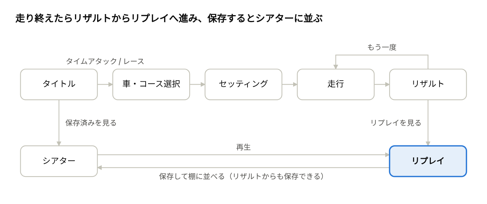
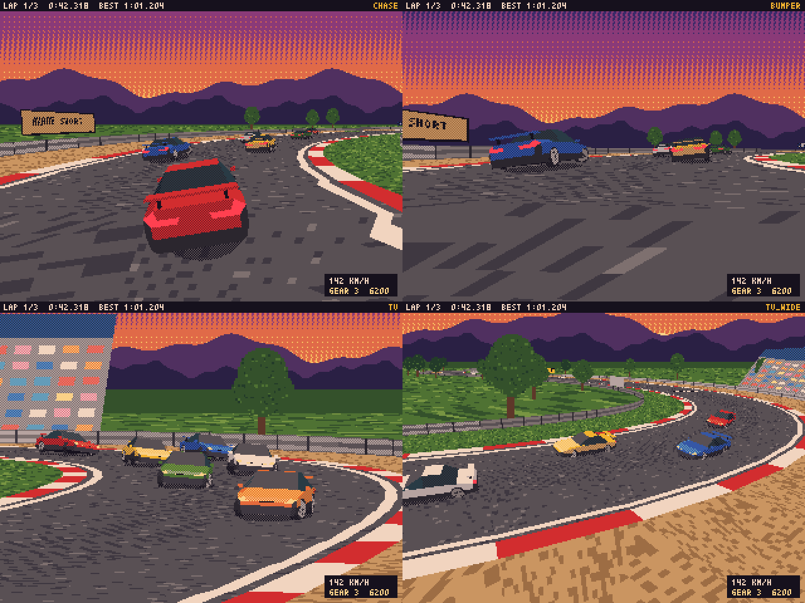

# Pyxelローポリレースゲーム企画書（CLIPPING POINT）

2026-11-11
CLIPPING POINT は、Pyxel 3.0標準の3D機能（Pyxel Cube）で初代PS時代のローポリ表現を再現し、市販車スタイルのスポーツカーでクローズドサーキットを周回するレースゲームです。見た目と挙動はリアル寄りに、セッティングは6項目の段階選択に絞ります。走行後のリプレイは保存でき、シアターで後から読み込んで再生できます。配布物はブラウザで動く単一HTMLファイル1本で、Pyxelの実行環境だけは起動時にネットから読み込みます。

この企画に基づく実装の設計は [実装設計](../design/overview.md)、開発の段取りは [開発計画](../plan.md) にあります。

## コンセプト

狙う体験は「挙動は本格派、準備は30秒」です。1プレイは3〜5分で、ブラウザを開いてすぐ走れます。

体験の柱は次の3本です。

1. 重さのある挙動。ブレーキで前に荷重を乗せて曲げる、駆動方式で立ち上がりが変わる、という手応えを出します。
2. 30秒で終わるセッティング。数値入力はなく、6項目を段階で選ぶだけです。
3. 走った後が本番。TV中継風のカメラで走りを観返し、気に入った1本を保存してシアターに並べます。

| 参考作 | 借りるもの | 捨てるもの |
| --- | --- | --- |
| 初代グランツーリスモ | リアル寄りの挙動、市販車スタイルの車、コースサイドカメラのリプレイ、低解像度ローポリの画面 | ライセンス試験、賞金と車の購入、大量の収録車種、パーツ単位のチューニング |
| 初代ファミリーサーキット | 少数項目を選ぶだけのセッティング、すぐ走り出せる構成 | 見下ろし視点 |

車とコースはすべてオリジナルです。実在の車名、メーカー名、コース名、ロゴは使いません。

## ゲームモード

モードは3つで、タイトルメニューから直接入れます。賞金、購入、アンロックはなく、全車・全コースを最初から選べます。

| モード | 内容 | 周回数 | 走る相手 | リプレイの対象 |
| --- | --- | --- | --- | --- |
| タイムアタック | 1台でベストラップを狙う | 無制限（やめるまで） | 自己ベストのゴースト1台 | 直近5周まで |
| シングルレース | グリッドスタートで順位を争う | 3 / 5 / 10周から選択 | AI車5台（計6台） | レース全体 |
| シアター | 保存したリプレイの一覧、再生、書き出し、読み込み | なし | なし | 保存済みの全リプレイ |

保存する記録は、コース×車ごとのベストラップと、シングルレースの最高順位だけです。

## 画面の流れ

タイトルから走行までは最短4画面です。走り終えたあとはリザルトを起点に、リプレイ、保存、再走へ分かれます。どの画面でも戻るボタンで1つ前へ、ポーズメニューからタイトルへ戻れます。

## 車両

収録は架空の市販スポーツカー6台で、駆動方式の違いがそのまま乗り味の違いになります。初期版は上の4台で、残り2台は初期版の公開後に追加します。

| 車名 | 駆動 | 出力 (ps) | 重量 (kg) | クラス | 性格 |
| --- | --- | --- | --- | --- | --- |
| ツバメ 1600 | FF | 165 | 1,040 | B | ホットハッチ。安定していて入門向き。攻めるとアンダーステア |
| カザネ RS | FR | 145 | 960 | B | 軽量2シーター。素直に曲がり、パワーは控えめ |
| シロガネ GT-T | FR | 280 | 1,340 | A | ターボクーペ。立ち上がりで踏みすぎるとリアが流れる |
| アラシ 4T | 4WD | 280 | 1,390 | A | ターボセダン。立ち上がり最速、重くて曲がりにくい |
| ミカヅキ MR | MR | 240 | 1,180 | A | ミッドシップ。回頭性は最高、限界を超えるとスピン |
| イカヅチ V8 | FR | 320 | 1,480 | A | 大排気量クーペ。直線が速く、ブレーキングが難しい |

- シングルレースのAI車は、プレイヤーと同じクラスの車で編成します。
- ボディカラーは1台につき4色から選べます。色違いは車ごとの色見本の塗り替えで作ります。
- 外観は90年代の国産スポーツカーを思わせる箱形と流線形で、1台220〜270ポリゴンを目安にします。

## セッティング

セッティングは6項目だけで、各項目を左右キーで段階選択します。全項目が中央なら標準状態で、触らずに走っても不利になりません。

| 項目 | 段階 | 左に振ると | 右に振ると |
| --- | --- | --- | --- |
| ギア比 | 5 | 加速重視。最高速が伸びない | 最高速重視。立ち上がりが鈍い |
| ウイング | 5 | ダウンフォース小。直線が速く、高速コーナーが不安定 | ダウンフォース大。高速コーナーが安定し、直線が遅い |
| サスペンション | 5 | ソフト。縁石や荷重変化に寛容で、反応が遅い | ハード。反応が鋭く、限界での動きが急 |
| ブレーキバランス | 5 | 前寄り。制動が安定し、曲がりにくい | 後寄り。ブレーキで向きが変わりやすく、スピンしやすい |
| トラクション | 5 | 回頭性重視。立ち上がりで内輪が空転しやすい | 立ち上がり重視。アクセルを踏むと車の癖が強く出る |
| ステアリング | 3 | マイルド。切れ始めが穏やか | クイック。小さな入力で大きく切れる |

トラクションはデフ（LSD）の効きを言い換えた項目です。このほかにドライバー設定が2つあります。

- 変速：AT / MT
- アシスト：ON / OFF。ONではブレーキロックとスピンを軽く抑えます。

ステアリングの項目は車側の舵の速さを変えるものです。コントローラーやキーの入力補正はこれとは別で、操作設定の画面で調整します。

画面は1枚で完結します。

- 左に項目リスト、右に車の3Dプレビューと、最高速・加速・コーナリング・安定性の4本バーを置きます。バーは設定に連動して伸び縮みします。
- 「おまかせ」ボタンで、コースごとの推奨値を1押しで適用します。
- 最後に使った設定を車×コースごとに記憶します。
- タイヤ選択、摩耗、燃料、パーツ交換はありません。

## コース

コースは架空のクローズドサーキット3本で、それぞれに逆走レイアウトがあります（計6レイアウト）。初期版はアカネ・ショート1本（順走のみ）で、残り2本と逆走レイアウトは初期版の後に追加します。数値は設計目標です。

| コース名 | 全長 (km) | コーナー数 | 時間帯 | 性格 | 効くセッティング |
| --- | --- | --- | --- | --- | --- |
| アカネ・ショート | 1.8 | 9 | 夕方 | 低中速のテクニカル。ヘアピン2か所。入門用 | 加速型ギア、高めのウイング |
| カスミ・ヒルズ | 3.2 | 13 | 薄曇り | 高低差40 m。上りの高速コーナーと下りのヘアピン | ブレーキバランス、サスペンション |
| ミナト・ベイ | 4.1 | 11 | 昼 | 900 mの直線2本を高速シケインでつなぐ | 最高速型ギア、低めのウイング |

- 路面はアスファルト、縁石、芝、グラベルの4種類です。芝はグリップが落ち、グラベルは大きく減速します。
- 外周はガードレールとタイヤバリアで囲みます。接触は減速するだけで、ダメージはありません。
- コースデータは中心線の制御点（位置、幅、バンク、高さ）で持ち、路面メッシュは起動時に生成します。
- スタンド、看板、ピット棟、木などの景観物と、リプレイ用固定カメラの設置位置もコースデータに含めます。
- 時間帯はコースごとに固定で、パレットの差し替えで表現します。天候の変化はありません。

## 走行挙動

車の動きは自前の車両モデルで計算し、路面の高さと傾きはコースデータから直接求めます。Pyxel Cube内蔵の物理は箱や球の剛体向けで、タイヤの限界や駆動方式の差を表せないため使いません。

| 要素 | 内容 |
| --- | --- |
| 車体 | 前後、横、ヨーの3自由度。高さと傾きは路面に追従。更新は毎秒60回の固定刻み |
| タイヤ | 4輪それぞれで、滑り角と、出せる力に対する前後力の使用率を計算。グリップは限界で頭打ちになり、超えると落ちる。前後力と横力は摩擦円で分け合う |
| 荷重移動 | 加減速と旋回で4輪の荷重が変わり、グリップが増減する。サスペンションの硬さが移動の速さを決める |
| 駆動系 | 車種ごとのトルクカーブと5速ギア。ターボ車は過給が遅れて立ち上がる。FF、FR、MR、4WDで駆動輪と前後重量配分が違う |
| 空力 | 速度の2乗に比例する空気抵抗とダウンフォース。前走車の真後ろでは抵抗が減る |
| 路面 | アスファルト、縁石、芝、グラベルで摩擦係数を切り替える |
| 接触 | 車同士と壁は押し戻しと減速だけ。ダメージなし |

「リアル寄り」の線引きは次のとおりです。

- 再現する：ブレーキを残して曲がると向きが変わる。踏みすぎるとFRはリアが、FFはフロントが外へ逃げる。縁石や芝で姿勢が乱れる。
- 再現しない：タイヤの温度と摩耗、燃料、ダメージ、天候、ピットイン、サスペンションの幾何学。

本命の操作はPCのアナログコントローラーです。キーボードや十字キーのデジタル操作でも、慣れればコースアウトせずに周回できることを目標にします。どちらの操作にも次の補正を入れます。

- ステアリングの応答カーブ：切り始めは穏やかに、深く倒すほど大きく切れます。カーブの形は調整できます。
- 車速に応じた最大舵角：速度が上がるほど最大の切れ角を絞り、高速域での切りすぎを防ぎます。
- カウンターステアの優先：車が滑っているときに逆へ切る操作は、最大舵角の制限を緩め、切る速さも上げます。
- アクセルとブレーキの踏み込みカーブ：踏み始めを細かく、奥で強く効かせます。カーブの形は調整できます。
- デジタル操作の追従：キーやボタンは0か1なので、舵角とペダルを目標値へ時間をかけて追従させます。追従の速さは調整できます。
- アシストON：ブレーキロックを防ぎ、駆動輪が滑り始めたら駆動力を絞ります。

調整項目は操作設定の画面にまとめます。

AI車はコースごとの理想ライン（位置と目標速度）を追います。強さはEASY、NORMAL、HARDの3段階で、目標速度の倍率とブレーキングの余裕で調整します。追い付き補正は入れません。

調整の目安は、アカネ・ショートをクラスAの車で約1分、クラスBの車で約1分5秒です。

## ビジュアル

3D描画には、Pyxel 3.0で追加された標準の3D機能 Pyxel Cube（`pyxel.cube`）を使います。テクスチャ付きメッシュ、深度テスト、ディザによる陰影までエンジン側が処理するので、ポリゴン描画を自作する必要はありません。

設計のための試作で描いた画面です。左上から、後方追従、バンパー、TVカメラ、TVカメラの広角です。コース、車、HUDはどれも仮の形です。

| 項目 | 仕様 |
| --- | --- |
| 画面解像度 | 320×240。ぼかさず整数倍で拡大表示 |
| フレームレート | 描画は30 fps。入力と物理は毎秒60回で処理する |
| パレット | 32色。コースの時間帯ごとに差し替える |
| 陰影 | 面単位の8段階。各段階を2色のディザ（網点）で表す |
| テクスチャ | 路面、縁石、看板、車の窓とライトに16〜64 px四方。補間なし |
| 車 | 1台220〜270ポリゴン。ボディ色は車ごとの色見本の塗り替え |
| コース | 画面内3,000〜5,000ポリゴン（路面、縁石、壁、スタンド、看板）。木と観客は板ポリゴン |
| 描画距離 | 約300 mで打ち切り。遠景は空と山並みの1枚絵 |

ポリゴン数は性能の上限ではなく、当時らしい粗さに合わせた値です。実測では、この規模で持ち時間に余裕があり、約2倍を描いても収まりました（技術構成の章）。

初代PSらしさは次の積み重ねで出します。

- 低解像度の画面をそのまま拡大し、ドットの角を残す。
- ポリゴンを少なくし、車も建物も角ばったシルエットにする。
- 粗いテクスチャを補間なしで貼り、遠くでちらつく質感を残す。
- 陰影をディザで付ける。Pyxel Cubeの標準の陰影がこの方式です。
- 描画距離を短くし、遠くの物が近づくと現れる見え方を許容する。
- 車の影は路面に貼る楕円の板影にする。

車と景観物のモデルは形の表からコードで生成し、路面はコースデータから生成します。

## リプレイ

走行を終えると、リザルトからそのままリプレイに入れます。記録は状態記録方式で、全車の位置と姿勢を毎秒20回保存し、再生時に間を補間します。

| 方式 | 仕組み | 長所 | 短所 |
| --- | --- | --- | --- |
| 状態記録（採用） | 全車の位置と姿勢を一定間隔で保存する | 巻き戻しと頭出しが自由。物理を調整した後の版でも古いリプレイを再生できる。再生時に物理計算が要らない | データが大きい |
| 入力記録 | 操作だけを保存し、再生時に物理を計算し直す | データが小さい | 巻き戻すには先頭から計算し直す。物理を少しでも変えると過去のリプレイが別の走りになる |

1台・1回分の記録は14バイトです。

| 内容 | バイト |
| --- | --- |
| 位置 x、y、z（各16ビット、水平は5〜11 mm刻み） | 6 |
| 向き（ヨー16ビット、ピッチとロール各8ビット） | 4 |
| 舵角 | 1 |
| エンジン回転数 | 1 |
| ギアとランプ類のフラグ | 1 |
| 滑りの量とアクセル開度 | 1 |

データ量は次の見積りです。1.8 kmの疑似コースを模擬走行させたデータでの試算で、圧縮は差分化とzlibです。実走データでは増減します。

| 対象 | 生データ (KB) | 圧縮後 (KB) | ブラウザ内保存時 (KB) |
| --- | --- | --- | --- |
| タイムアタック1周（1台、90秒） | 25 | 9 | 12 |
| レース（6台、5分） | 504 | 151 | 201 |
| レース（6台、10分） | 1,008 | 292 | 389 |

カメラは4種類です。

| カメラ | 内容 |
| --- | --- |
| TV（既定） | コースサイドの固定カメラが車を追い、区間が変わると自動で切り替わる |
| チェイス | 後方から追う。走行時と同じ |
| 車載 | バンパー位置 |
| ヘリ | 上空から見下ろして追う |

再生中の操作は次のとおりです。

- 一時停止、スロー（1/2、1/4）、早送り（2倍、4倍）、巻き戻し
- 周回単位の頭出し
- 注目する車の切り替え（レースのみ）
- HUDの表示切替
- 直近10秒をGIFとして保存（Pyxelの画面録画機能）

タイムアタックのゴーストも同じ記録データで動かします。

## シアター

シアターは保存したリプレイの棚です。一覧から選んで再生でき、ファイルとして持ち出すこともできます。

一覧には名前、コース、車、モード、結果（ベストラップまたは順位）、保存日時を表示します。並べ替えは日時、コース、タイムの3通りです。

| 操作 | 内容 |
| --- | --- |
| 再生 | 走行直後のリプレイと同じ画面、同じ操作で再生する |
| 名前変更 | 英数字16文字まで |
| 削除 | 確認つき |
| 書き出し | `.cpr` ファイルとしてダウンロードする |
| 読み込み | `.cpr` ファイルをゲーム画面にドラッグ＆ドロップする。スマホではファイル選択ダイアログを使う |
| ゴーストに設定 | タイムアタックのリプレイを、同じコースのゴーストとして走らせる |

保存先は2段構えにします。

| 保存先 | 役割 | 上限 | 注意点 |
| --- | --- | --- | --- |
| ブラウザ内（localStorage） | ふだんの保存。次に開いたときも棚に残る | 12本、合計3 MBまで | ブラウザのデータ消去で消える。HTMLをローカルファイルとして開いた場合に残るかはブラウザ次第 |
| ファイル（`.cpr`） | 持ち出し、バックアップ、受け渡し | なし | 書き出しと読み込みは手動 |

- 上限に達したら、保存時に入れ替えるリプレイを選びます。
- ブラウザ内への保存に失敗したら、その場でファイル書き出しを案内します。

Web版Pyxelでの実現方法は、ランタイムのコードを読んで確かめました。

- ランタイムにはブラウザ内へデータを残す機能がありません。Pyodide経由でブラウザのlocalStorageを直接読み書きします。
- ファイルのドロップ読み込みは、Pyxelがドロップされたファイルを受け取る仕組みを使います。
- ダウンロードとスマホ用のファイル選択は、Pyodide経由でブラウザの機能を呼びます。

`.cpr` ファイルはヘッダ、本体、チェックサムの3部構成です。

- ヘッダ：識別子、形式バージョン、コースとレイアウト、モード、各車の車種・色・セッティング、ラップタイム、保存日時、名前
- 本体：圧縮した走行記録
- チェックサム：読み込み時に形式バージョンとあわせて検証し、壊れたファイルは棚に入れずエラーを表示する

## 操作・HUD・サウンド

本命の操作はPCのアナログコントローラーです。全操作を十字キーと6ボタンにも収めるので、キーボードとスマホの画面上パッドでも遊べます。

| 操作 | キーボード | ゲームパッド・画面上パッド |
| --- | --- | --- |
| ステアリング | ← → | 左スティック（十字キー左右も可） |
| アクセル | Z | 右トリガー（Aボタンも可） |
| ブレーキ・バック | X | 左トリガー（Bボタンも可） |
| シフトアップ（MT） | S | X |
| シフトダウン（MT） | A | Y |
| 視点切替 | C | BACK |
| ポーズ | Enter | START |

- 画面上パッドはPyxel Web標準のバーチャルゲームパッド（十字、A/B/X/Y、START/BACK）をそのまま使います。
- 視点はバンパー視点と後方追従視点の2種類です。

逆向きや壁際で動けなくなったときは、ポーズメニューからコースの中央へ戻せます。

操作の補正は、操作設定の画面で調整できます。項目はどれも5段階で、アナログ操作用とデジタル操作用を別々に保存します。ペダルの割り当ては、トリガー、ボタン、右スティックの上下から選べます。

| 項目 | 変わること | 対象 |
| --- | --- | --- |
| STEER CURVE | 切り始めの穏やかさ。アナログでは倒した量に対する切れ角のカーブ、デジタルでは押し始めの速さ | アナログ、デジタル |
| STEER SPEED | 舵が動く速さ。デジタルでは最大舵角に達するまでの時間 | アナログ、デジタル |
| SPEED LOCK | 車速に応じて最大舵角を絞る強さ | アナログ、デジタル |
| COUNTER | カウンターステアのときに最大舵角の制限を緩める強さ | アナログ、デジタル |
| THROTTLE CURVE | アクセルの踏み込み量のカーブ | アナログ |
| BRAKE CURVE | ブレーキの踏み込み量のカーブ | アナログ |
| PEDAL SPEED | ボタンを押してから全開、全制動になるまでの時間 | デジタル |
| DEAD ZONE | スティックの中央の遊び | アナログ |

HUDは画面の四隅に置きます。

- 左上：順位と周回（例：POS 2/6、LAP 3/5）
- 右上：現在ラップ、ベストラップ、前周との差
- 左下：コース略図と各車の位置
- 右下：速度（km/h）、ギア、タコメーターのバー

画面内の文字は英数字だけにします。Pyxel内蔵フォントで足りるため、フォントの同梱が要りません。

サウンドはPyxel内蔵音源を8チャンネルに増やして使います。走行中にBGMは鳴らしません。

| ch | 用途 |
| --- | --- |
| 0 | 自車エンジン音。ごく短い音を鳴らし続け、その高さを回転数に合わせて書き換える |
| 1 | タイヤの音。スキール音は滑り量で音量が変わる。芝やグラベルでは走行音に変わる |
| 2 | 効果音（接触、縁石、変速、カウントダウン） |
| 3 | 最も近い他車1台のエンジン音 |
| 4〜7 | BGM。走行中は鳴らさない。リプレイ中は旋律とベースの2本だけ鳴らす |

BGMはメニュー、リプレイ、リザルトの3曲です。

## 技術構成

配布物は `pyxel app2html` が出力するHTMLファイル1本です。ゲーム本体（コード、モデル、テクスチャ、音）はすべてこのファイルに埋め込まれますが、Pyxelの実行環境だけは起動時にネットから読み込まれます。

ビルドの手順は次のとおりです。

1. PythonとPyxel 3.0.1で開発し、デスクトップ版で動作を確かめる。
2. `pyxel package` でアプリ一式を `.pyxapp` にまとめる。
3. `pyxel app2html` で `.pyxapp` を埋め込んだHTMLを出力する。
4. ブラウザで開いて確かめる。

Pyxel 3.0.1で最小のアプリを実際に変換し、出力を確かめました。

- 出力HTMLは、ランタイム `https://kitao.dev/pyxel/3.0.1/pyxel.js` を読み込むタグと、base64化したアプリ本体を渡す起動コードだけでできています。
- ランタイムはPyodide 314.0.7とPyxelのWebAssembly版で、kitao.devから取得されます。起動にはネット接続が要り、完全オフラインで動くHTMLにはなりません。
- 画面上パッドは有効の状態で出力されます。

| 層 | 採用するもの |
| --- | --- |
| 言語とエンジン | Python、Pyxel 3.0.1（版を固定） |
| 3D描画 | Pyxel Cube |
| 車両物理、AI、リプレイ | 自前のPythonコード。標準ライブラリのみを使い、追加パッケージのダウンロードを避ける |
| リプレイの圧縮 | Python標準のzlib |
| 保存とファイル入出力 | 保存層を1つ挟み、ブラウザ版はPyodide経由、デスクトップ版は通常のファイルで処理する |
| アセット | 車と景観物は形の表、テクスチャはコードで描く。音はMMLの文字列 |

HTMLのサイズは1 MB以下を目標にします。

処理は毎秒60回の更新（入力と物理）と毎秒30回の描画に分けます。描画1回の持ち時間33.3 msの中に、更新2回と描画1回が入ります。実測は次の状況です。

| 処理 | デスクトップ版 | ブラウザ版 |
| --- | --- | --- |
| 車両物理（6台の更新1回） | 約0.18 ms | 約0.32 ms |
| 3Dの実描画1回（約7,000ポリゴン） | 約2.3〜3.0 ms | 約3.1〜4.8 ms |

デスクトップ版はLinux版Pyxel 3.0.1を画面なしで動かした値、ブラウザ版はヘッドレスのChromiumで動かした値です。更新2回と実描画1回の合計は、ブラウザ版でも持ち時間の3割に届きません。実機のPCやスマホでは未計測です。

## 開発ステップ

開発は、土台と検証の仕組みを置く立ち上げ（段0）の後、走りの核、リプレイとシアター、レース、仕上げと公開の4段で進めます。段の並び、区切り、通過条件は [開発計画](../plan.md) にあります。

## リスクと決定事項

ブラウザ版の実行速度は、試作の実測で余裕があると分かりました。残る大きなリスクは、操作の手触りと、実機での確認を開発環境で行えないことです。

| リスク | 起きること | 対策 |
| --- | --- | --- |
| デジタル入力ではリアル寄りの挙動が扱いにくい | 難しすぎて遊べない | 操作補正を調整できるようにし、アシストONを標準にする。走りの核を作る段階で手触りを確定させる |
| 実物のコントローラー、音、実機のブラウザを開発環境で確かめられない | 手触りや音が意図と違うまま進む | 段の終わりごとに、生成したHTMLでの試走と試聴をお願いする |
| 性能の低いPCやスマホで処理が間に合わない | 毎秒60回の更新と30 fpsの描画を保てない | 開発環境のブラウザ版では持ち時間の3割以下に収まった。実機で不足したら、描画するポリゴン数、台数（6台から4台）の順で減らす |
| ブラウザ内保存が消える、または使えない | リプレイを失う | ファイル書き出しを常に併設する |
| ランタイムの配信元に依存する | オフライン時や配信停止時に起動しない | 版を固定したURLで読み込む（app2htmlの標準動作）。必要になれば自前ホスティング版を用意する |
| Pyxel Cubeは3.0.0で入った新しい機能 | 不具合や仕様変更に当たる | Pyxelの版を3.0.1に固定する |
| 見た目が初代PSらしく見えない | 企画の魅力が落ちる | 試作で方向は確かめた。路面の模様と車の細部は仕上げの段で作り込む |

今回の検討で次の7点が決まりました。

| 論点 | 決定 |
| --- | --- |
| 単一HTMLの形 | 実行環境は起動時にネットから読み込む。Pyxelのブラウザゲームの標準的な形に従う |
| フレームレート | 描画は30 fps。入力と物理は毎秒60回 |
| 画面内の文字 | 英数字のみ |
| 名称 | タイトル、車名、コース名は本書のとおりで確定 |
| 初期版の範囲 | 車4台、コース1本 |
| 操作 | PCのアナログコントローラーが本命。デジタル操作でも慣れれば周回できる補正を入れ、補正カーブは調整できるようにする |
| セッティング | 6項目で確定 |

着手前の確認で、次の4点も決まりました。

- 音は8チャンネルにする。
- 初期版に逆走レイアウトは入れない。コースデータ、保存、リプレイには、レイアウトの欄を最初から持たせる。
- 初期版はHTMLファイルをお渡しするところまでとし、Webに置く場所は別に決める。
- GIF保存は、リプレイとシアターを作る段の最後に実測し、負担が大きければ初期版では見送る。

## 出典

- [Pyxel CHANGELOG](https://github.com/kitao/pyxel/blob/main/CHANGELOG.md)：3.0.0でのPyxel Cube追加、Pyodideの版、app2htmlの変更点
- [Pyxel Webランタイム pyxel.js](https://github.com/kitao/pyxel/blob/main/wasm/pyxel.js)：ランタイムの取得元、ファイルのドロップ読み込み、ダウンロード処理、バーチャルゲームパッド
- [Pyxel 3.0.1（PyPI）](https://pypi.org/project/pyxel/)：同梱の型定義、Pyxel Cubeのサンプル、`cli.py`。API仕様とapp2htmlの出力は、このパッケージを実際に動かして確かめました。

処理時間とリプレイ容量の数値は、上記パッケージを使った今回の試作と計測によるものです。初代ファミリーサーキットのセッティング項目は一次情報を開けなかったため、項目の構成は本企画で独自に決めています。
