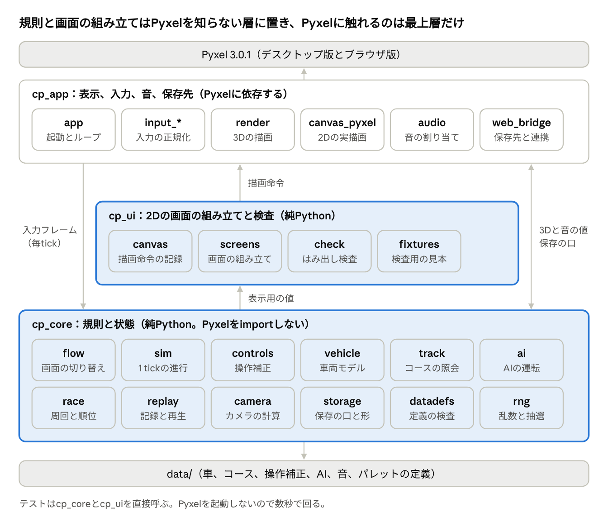
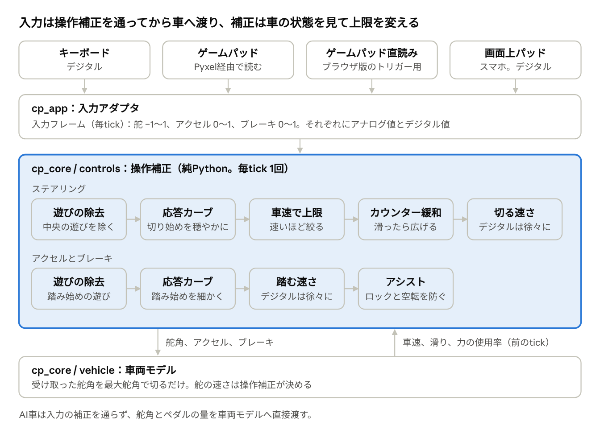
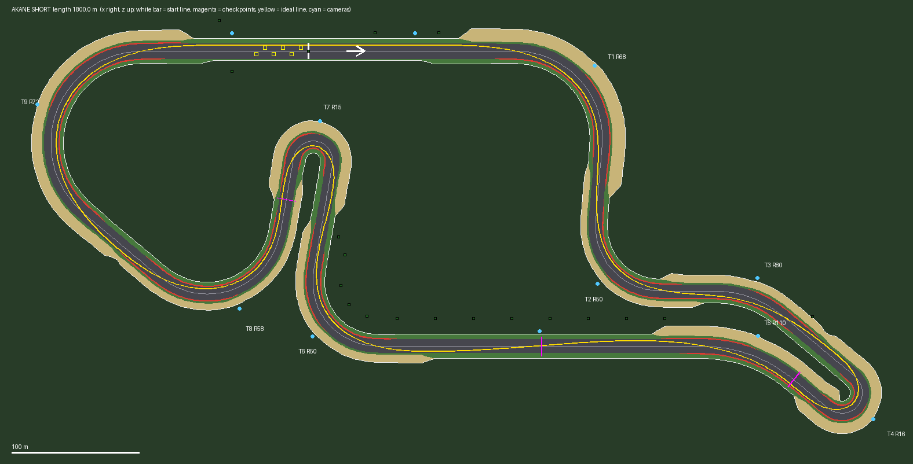
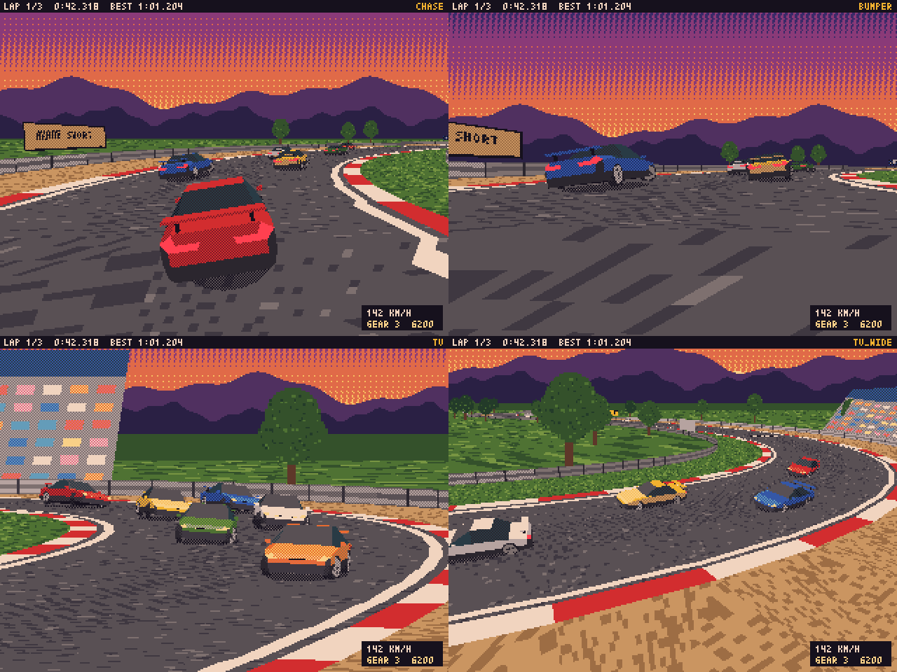

# CLIPPING POINT 実装設計

2026-11-11
ゲームの規則と状態はPyxelを参照しない純Pythonのライブラリに置き、2Dの画面の組み立ても純Pythonの層に分けます。Pyxelに触れるのは最上層だけの3層構成です。更新は毎秒60回の固定刻み、描画は毎秒30回です。本書は全体の設計で、段ごとの詳細設計は各段の開始時に書きます。

## 設計の前提

後から変えると全体に響く値を、最初に固定します。ここだけは仮の値で進めません。

| 項目 | 値 | 変えると響く所 |
| --- | --- | --- |
| 画面 | 320×240。整数倍で拡大表示する（起動時にPyxelの整数倍表示を有効にする） | HUDと全画面の配置、スクリーンショットの基準 |
| 時間の刻み | 1 tick = 1/60秒の固定刻み。入力、操作補正、物理、AI、レースの時計はすべてtickで進む | リプレイの形式、指紋テストの基準、車両の値の調整 |
| 描画 | 毎秒30回。補間はせず、最新のtickの状態を描く | カメラの滑らかさ |
| リプレイの記録 | 3 tickごと（毎秒20回） | ファイル形式 |
| 単位 | 長さ m、時間 s、角度 rad、質量 kg、力 N。表示だけ km/h と度 | すべての定義データ |
| 座標 | 平面は (x, z)、高さは y（上が正）。向きは +x が 0、+z が +π/2 で、値が増える方向が左旋回 | コースデータ、リプレイ、描画への変換 |
| 数値の型 | 物理は浮動小数。保存する時刻は整数のtick、ラップタイムは整数のミリ秒、リプレイは量子化した整数 | 保存データの互換 |
| 環境の差 | 浮動小数の計算結果はデスクトップ版とブラウザ版で一致しない前提で作る。保存と比較は整数で行う。指紋テストの基準はデスクトップ版で持ち、ブラウザ版は短い台本を許容差つきで突き合わせる | テストの組み方、リプレイの方式 |
| 文字 | 英数字のみ。内蔵フォントは1文字4×6ピクセル | UIの配置 |
| 色 | パレット32色 | テクスチャとモデル |
| Pyxelの版 | 3.0.1に固定 | Pyxel CubeのAPI、ブラウザ版のランタイム |

環境の差は実測に基づきます。sin、cos、atan2の数学関数は、試した入力の2〜24%で、デスクトップ版とブラウザ版の結果が最下位1ビットだけ違いました。リプレイを状態記録方式にした判断は、この結果で裏付けられています。

## 全体構成



入力フレームは毎tickロジックへ渡り、ロジックは表示用の値を返します。2Dの画面は `cp_ui` が描画命令の列に組み立て、`cp_app` がそれをPyxelで実行します。3Dと音の値、保存先とのやり取りは、`cp_core` と `cp_app` の間で直接行います。

層の間の決まりは次の5つです。

- `cp_core` と `cp_ui` はpyxelをimportしない。使ってよい標準ライブラリを一覧で決め、それ以外のimportはソースの検査で落とす。乱数と時刻の標準ライブラリも使わない。
- 依存は一方向にする。`cp_app` は `cp_ui` と `cp_core` を、`cp_ui` は `cp_core` を呼ぶ。逆向きには呼ばない。
- 2Dの描画は必ず `cp_ui` の描画命令を通す。Pyxelの描画関数を直接呼ばない。画面のはみ出しを機械で数えるためです。
- 画面の状態、カメラの位置の計算、音の要求の組み立ても `cp_core` に置く。画面遷移やTVカメラの切り替えを、画面なしのテストで確かめるためです。
- AI車は入力の補正とアシストを通さず、舵角とペダルの量を直接出す。舵の速さの制限だけは、操作補正と同じ関数を使う。掛けるのは舵そのものの速さの上限（毎秒1.0 rad×セッティングの倍率）だけで、操作設定の段階は読まない。

## ディレクトリとモジュール

出荷するアプリは `clipping_point/` の下だけに置き、テスト、道具、文書はその外に置きます。

| 置き場 | 中身 | 出荷物に入るか |
| --- | --- | --- |
| `clipping_point/main.py` | 起動スクリプト。`cp_app` を呼ぶだけ | 入る |
| `clipping_point/cp_core/` | 規則と状態。純Python | 入る |
| `clipping_point/cp_ui/` | 2Dの画面の組み立てと検査。純Python | 入る |
| `clipping_point/cp_app/` | Pyxelとブラウザに触れる部分 | 入る |
| `clipping_point/data/` | 定義データ（JSON） | 入る |
| `tests/` | ロジックのテスト、守りのテスト、ふるまいの写し | 入らない |
| `testpacks/` | 試験用のデータ | 入らない |
| `tools/` | 検証のラッパー、ブラウザ版の検証道具、Claude Codeの作業補助 | 入らない |
| `docs/` | 正本、設計、改訂案、作業記録、控え、言葉の表 | 入らない |
| `.claude/` | 規則ファイル、サブエージェントの型、設定 | 入らない |
| `out/`、`dist/`、`.cache/` | 生成物とランタイムの写し。gitの外 | 対象外 |

テクスチャと車のモデルはコードとデータから作るので、初期版は画像やモデルのファイルを持ちません。

| 層 | モジュール | 役割 |
| --- | --- | --- |
| `cp_core` | `fixed_loop` | 実描画するかどうかの判定 |
| `cp_core` | `sim` | 世界の状態と1 tickの進行 |
| `cp_core` | `flow` | 画面の状態と切り替え、表示用の値 |
| `cp_core` | `input_frame`、`input_script` | 入力フレームとその量子化、台本 |
| `cp_core` | `controls` | 操作補正 |
| `cp_core` | `vehicle` | 車両モデル |
| `cp_core` | `track` | コースの表、照会、メッシュ用の数値 |
| `cp_core` | `ai` | AIの運転 |
| `cp_core` | `race` | 周回、順位、タイム |
| `cp_core` | `replay` | 記録、再生、`.cpr` の読み書き |
| `cp_core` | `camera` | カメラの位置と向き |
| `cp_core` | `audio_model` | 音の要求（回転数、滑り、出来事） |
| `cp_core` | `storage`、`profile` | 保存の口と、保存する項目 |
| `cp_core` | `datadefs` | 定義データの読み込みと検査 |
| `cp_core` | `rng` | 用途別の乱数と、ハッシュでの抽選 |
| `cp_ui` | `canvas` | 描画命令（文字、矩形、線、画像）とその記録 |
| `cp_ui` | `screens` | 画面ごとの組み立て |
| `cp_ui` | `check` | はみ出しの検査 |
| `cp_ui` | `fixtures` | 検査用の見本データ（ふつうの値と極端な値） |
| `cp_app` | `app` | 起動とメインループ |
| `cp_app` | `input_pyxel`、`input_web` | Pyxelとブラウザの入力を入力フレームにする |
| `cp_app` | `input_trace` | 検証のときに、入力フレームの変わり目を残す（入力の跡）。残した値は世界へ渡さない |
| `cp_app` | `render` | Pyxel Cubeのシーン、モデル、カメラの反映 |
| `cp_app` | `canvas_pyxel` | 描画命令の実行 |
| `cp_app` | `audio` | チャンネルへの割り当てと再生 |
| `cp_app` | `storage_web`、`web_bridge` | localStorage、ダウンロード、ファイル選択。`web_bridge` は、ブラウザ版の煙テストが外から渡す値を読む所と、結果をコンソールへ出す所も持つ |
| `cp_app` | `perf` | 更新1回と実描画1回の時間と、毎秒の回数を集める。測った値は世界へ渡さない |

層の分離は、ソースを解析して許可した一覧と照らす検査で守ります。試作では、`cp_core` にpyxelを持ち込む12通りの書き方をこの検査がすべて検出しました。実行時にimportを見張るだけの方式は9通りしか検出できませんでした。

## メインループ

Pyxelの周期を毎秒60回に設定し、更新1回を1 tickとします。描画は、前回の実描画から2 tick以上、または1 tick以上かつ30 ms以上たったときだけ行い、毎秒30回に間引きます。ブラウザ版で実際に動かし、毎秒60.0回の更新と30.0回の描画を確認しました。

1回の周期は次の順で進みます。

1. 入力を1度だけ読み、正規化した入力フレームを作る。
2. ロジックを1 tick進める。走行中は、全車の操作（自車の操作補正とAI）、全車の車両モデル、当たり、周回判定と順位、リプレイ記録の順。
3. ロジックが出した音の要求を音源へ反映する。
4. 描画の番なら、裏画面に3DとHUDを描く。
5. 裏画面を画面へ写す。これは毎回行う。

| 項目 | 決めたこと | 理由 |
| --- | --- | --- |
| 周期 | `pyxel.init(320, 240, fps=60)`。更新1回が1 tick | 1回の更新で2 tick進める形にすると、入力の読み取りが毎秒30回に落ち、ボタンを押した瞬間の判定が2 tickに重なる |
| 描画の間引き | 前回の実描画から2 tick以上、または1 tick以上かつ30 ms以上たったら描く | フレーム番号の偶奇で間引くと、処理落ちから追い付く間に偶奇が固定され、描画が0回になる（実測） |
| 裏画面 | 3DとHUDは320×240の裏画面に描き、毎回画面へ写す | 描かない周期でもPyxelが性能表示とカーソルを画面に描き足すため、直接描くと古い絵に重なる |
| 処理落ち | 遅れた分の更新をPyxelが先に回し、描画を飛ばす。1周期が100 msを超えるとゲームが遅くなる | Pyxel本体の動作（ソースと実測） |
| ロジックの時計 | tickだけを数える。fps、フレーム番号、実時間は読まない | 同じ入力から同じ結果を出すため |
| 終了キー | Escで終了させず、Enterと同じくポーズに使う。Escは企画書の操作表への追加 | ブラウザ版で終了するとメインループが止まり、戻れない |

描画の間引きには実時間を使いますが、見た目だけの判断なのでロジックの結果には影響しません。

処理時間は、描画1回の持ち時間33.3 msの中に更新2回と実描画1回が入れば足ります。ブラウザ版の実測では合計が約5〜9 msで、持ち時間の3割に届きません。

| 処理 | ブラウザ版の実測 | 条件 |
| --- | --- | --- |
| 車両6台の1 tick | 平均0.32 ms、95%点0.5 ms | 実際の更新ループの中で1,200回 |
| 音の更新 | 平均0.1 ms | 同上 |
| リプレイの記録 | 平均0.007 ms | 6台 |
| 実描画1回（背景、3D約7,000ポリゴン、HUD） | 中央値3.1〜4.8 ms、95%点4.1〜7.9 ms | 視点により変わる。各84回 |
| 実描画1回（約12,500ポリゴンの重い版） | 中央値4.1〜5.6 ms、95%点6.3〜8.6 ms | 同上 |

実測はこの作業環境のヘッドレスのChromiumでの値です。デスクトップ版はこの約半分です。実機のPCやスマホでは測っていないので、更新1回が4 ms、実描画1回が12 msを超えたら見直す、という仮の上限を置きます。

起動時の設定は次の3つを固定します。

- 画面の拡大は整数倍にする。Pyxelの既定は窓に合わせた端数の倍率で、画素の幅が不ぞろいになる。スマホで小さくなりすぎる場合の扱いは、実機で見て決める。
- 画面の録画は切っておく（`capture_sec=0`）。既定のままだと直近10秒分の画面を常に保持し、デスクトップ版の実測で約44 MBを使う。GIF保存を載せるときだけ有効にする。
- 終了キーは無効にする。

ブラウザ版でタブが隠れると、Pyxelは更新を呼ばなくなります。tickは止まりますが、音を止める処理も走らないので、鳴っていた音はそのまま鳴り続けます。批評の中で、更新が回らない状態をブラウザ版ランタイムで模して確かめました。ブラウザからタブが隠れた合図を受けて全チャンネルを止め、戻ったときに走行中ならポーズへ、リプレイ中なら一時停止へ入れます。実物のブラウザでの確認は、段1の終わりの試走で行います。

## 入力と操作補正

入力は、機器ごとの差をアダプタで吸収して「入力フレーム」にそろえます。操作補正は、車の状態を見ながら入力フレームを舵角とペダルの量に直します。試作を車両モデルとコースにつないで周回させたところ、補正なしでは周回できず、補正とアシストを入れると4車種すべてが周回できました。ただし、デジタル操作のFF車と4WD車がコーナー出口で外へはみ出す課題が残っています。



### 入力アダプタと入力フレーム

| 機器 | 読み方 | 扱い |
| --- | --- | --- |
| キーボード | Pyxel | デジタル |
| ゲームパッドの左スティック | Pyxel | アナログ |
| ゲームパッドの十字キーとボタン | Pyxel | デジタル |
| トリガー（デスクトップ版） | Pyxel | アナログ |
| トリガー（ブラウザ版、標準の並びのコントローラー） | ブラウザのGamepad APIを直接読む | アナログ |
| トリガー（ブラウザ版、それ以外のコントローラー） | Pyxel | デジタル |
| 画面上パッド | Pyxel | デジタル |

ブラウザ版でトリガーを直接読むのは、Pyxel経由だと0か最大かの2値でしか届かないためです（偽のコントローラーを差し込んで確認）。直接読めばアナログ値が取れます。かかる時間は、小さな繰り返しで測ると1回約0.05 ms、実際のメインループの中では約0.12 msでした（段0の区切り5での実測。コントローラーをつないでいないときも、毎tick読むので同じだけかかります）。

入力フレームは次の値を持ちます。

- 舵のアナログ値（−1〜1、左が正）とデジタル値（−1、0、1）。
- アクセルとブレーキそれぞれの、アナログ値（0〜1）とデジタル値（0か1）。
- シフト、視点切替、ポーズ、メニュー操作の「押している」と「押した瞬間」。

入力の取り込みの決まりは次の5つです。

- アダプタは値の範囲をそろえるだけにする。遊びの除去とカーブは操作補正に置き、画面なしでテストする。
- アナログ値とデジタル値のどちらを使うかは、操作補正が舵、アクセル、ブレーキごとに毎tick決める。デジタル値が0でなければデジタル、アナログ値が遊びを超えていればアナログ、どちらでもなければ直前の扱いを保つ。
- トリガーが2値でしか届かない経路では、アダプタがトリガーをデジタル値の側へ入れる。
- ペダルの割り当ては、操作設定でTRIGGER（既定）、BUTTON、R-STICK（右スティックの上下）から選べる。トリガーをアナログで読めない環境でも、右スティックでアナログ操作ができる。このときのペダルの遊びには、DEAD ZONEの値を使う。
- テストと画面なしの実行では、台本に書いた入力フレームをそのまま差し込む。

### ステアリングの補正

毎tick、次の順で舵角の指令を作ります。

1. 遊びの除去（アナログ）。入力の大きさがDEAD ZONE以下なら0、0.97以上なら1とし、その間を直線で伸ばす。
2. 応答カーブ（アナログ）。`y = x + k * (x^3 - x)` を使う。kが0なら直線で、kを大きくするほど切り始めが穏やかになる。中心の傾きは 1 − k で、0にはならない。
3. 車速に応じた最大舵角。下の式で上限を決め、カーブの出力に掛ける。スティックの全倒しとキーの押しっぱなしが、この上限に当たる。
4. カウンターステアの緩和。後輪が滑っていて、入力が立て直す向きのときだけ、上限を広げ、切る速さを上げる。
5. 切る速さの制限。実際の舵角から目標へ、決めた速さで近づける。

応答カーブにべき乗（xのp乗）を使わないのは、中心の傾きが0になり、切り始めに反応しない帯ができるためです。

最大舵角の式は次のとおりです。

```
上限 = min(車の最大舵角, ka × L × a ÷ v² + km × αp)
```

- L はホイールベース、v は車速、αp はタイヤが最大グリップを出す滑り角。
- a はその路面で出せる横加速度。路面の摩擦係数 × タイヤの摩擦係数 × 重力加速度で求め、路面の摩擦係数は0.5を下限にする。
- 第1項は、その速度でグリップの限界まで曲がるのに要る舵角。第2項は余裕。
- 車速が1 m/s未満のときは、車の最大舵角（31.5度）をそのまま使う。
- 値は車から読むので、4車種に同じ係数を使える。サスペンションのセッティングで αp が変わると、上限も付いて変わる。

余裕の係数 km は0.1〜0.3が適正でした。前輪の最大グリップの滑り角をそのまま足す（kmが約1）と、前輪が効きすぎて後輪が先に限界を超えます。定常旋回では車体が内側を向くので、舵角に足す量は前後の滑り角の差だけで足りる、というのが実測に合う説明です。

カウンターステアと判定するのは、次の4つがそろったときです。

- 後輪が横の限界に近い。後軸の滑りが、最大グリップを出す滑りの0.95倍を超える（1.35倍で緩和が全開になる）。
- 車体の滑り角が3度を超え、後軸の流れと同じ向きである。
- 車速が5 m/sを超え、前進している。
- 入力が、後輪の流れる向きへ切る操作である。

緩和中は、上限を「前輪を、前輪が進んでいる向きへ向ける舵角 ＋ 余裕」まで広げ、切る速さを最大2〜3倍にします。余裕と倍率はCOUNTERの段階で変わります。滑りが収まると、0.3秒の時定数で元の上限へ戻します。入力なしに自動で逆へ切る機能は入れません。

切る速さは「上限に対する割合」で決めます。上限は車速とともに縮むので、高速ほど舵はゆっくり動きます。

- アナログは、値の急な飛びを除く程度にする（既定で全域0.09秒）。
- デジタルは、押し始めを遅く、押し続けると速くする。既定では押し始めが平均の0.35倍で、0.19秒かけて1.28倍まで上がり、0.32秒で上限に達する。0.05秒の押しで上限の7%、0.1秒で17%、0.2秒で50%になる。
- キーを離すと0.21秒で中央へ戻る。逆のキーを押したときも、中央までは戻りの速さで動く。

舵の速さを決めるのは、この1か所だけにします。車両モデルは受け取った舵角を最大舵角で切るだけにし、セッティングの「ステアリング」は、操作補正が決める切る速さに掛ける倍率（マイルド0.7、標準1.0、クイック1.4）として読みます。舵そのものが動ける速さの上限（標準で毎秒1.0 rad）にも同じ倍率を掛け、カウンターの緩和中はさらに緩和の倍率を掛けます。車側の舵の速さを上限として読むだけの形では、中高速では操作補正の速さが先に効き、セッティングの差が出ません。試作では車両モデルと操作補正の両方が速さを制限していて、車側の制限がカウンターの戻しを遅らせ、逆側への振り返しを招いていました。滑っている間だけ車側の速さも上げると、周回でのスピンがカザネで14回から5回に減りました。AI車の舵には、同じ関数で、舵そのものの速さの上限（毎秒1.0 rad×セッティングの倍率）だけを掛けます。操作設定の段階は読まないので、AI車の走りは保存してある操作設定では変わりません。

この写し方は、企画書の説明と違います。企画書は「ステアリング」を車側の舵の速さを変える項目とし、入力補正とは別のものとしています。倍率として写すと、操作設定のSTEER SPEEDと同じ量を重ねて動かすことになり、クイックの1.4倍はデジタルのSTEER SPEEDの約1.5段分に当たります。この違いは、企画書の改訂案の1件目に起こします。クイックとSTEER SPEEDのFASTを重ねた場合（デジタルで0から上限まで約0.14秒）も、段1で確かめる範囲に入れます。

試作で確かめた結果は次のとおりです。

| 確かめたこと | 結果 |
| --- | --- |
| 補正なしで全倒しを3秒 | 60〜180 km/hの全車で、前輪の滑りが限界の4〜6倍になり、横加速度が0.65〜0.77 gに落ちる |
| 余裕の係数kmを0にする | 高速で曲がらない。180 km/hで最大0.52〜0.67 g |
| 余裕の係数kmを0.65にする | カザネが180 km/hで車体の滑り角23度まで滑る |
| アナログの既定で全倒し（100 km/hと180 km/h） | 最大横加速度0.93〜1.02 g、車体の滑り角4〜8度、スピン0。カザネの180 km/hだけ16.6度まで滑る |
| デジタルの既定でキーを押しっぱなし（60〜180 km/h） | 16走行すべてで最大横加速度0.86〜0.99 g、車体の滑り角1.1〜7.3度、スピン0 |
| 180 km/hの直線でキーを短く押す | 0.1秒で横へ0.5 m、0.2秒で2.9 m動く。補正なしでは0.1秒で16.8 m動く |
| カウンターの緩和をなくす | カザネが滑り角78度でスピンする |
| カウンターの既定（時速53 kmの旋回でアクセルを踏みすぎた場面） | 滑り角13.6度で止まり、逆側への振り返しは1.5度、1.3秒で復帰する |
| カウンターの余裕を広げすぎる | 逆側へ36〜84度振り返す。段階には入れない |
| 滑っていない切り返し（0.5 Hz、10秒） | 振幅70%では全車でカウンターの誤判定0。振幅95%・140 km/hのFR車では判定が立つが、このとき後輪は実際に滑っている |
| 前輪の滑り角で舵を切り詰める方式 | FR車のスピンを増やしたので採らない |

### アクセルとブレーキの補正

- 遊びの除去（アナログ）。0.04以下を0、0.97以上を1とする。
- 応答カーブ（アナログ）。ステアリングと同じ式で、アクセルとブレーキを別々に調整できる。kを大きくするほど踏み始めが細かくなる。
- 踏む速さ。アナログは値の飛びを除くだけにする（全域0.06秒）。デジタルは0と1の間を時間をかけて動かす。既定はアクセルが踏み込み0.28秒・戻し0.12秒、ブレーキが踏み込み0.18秒・戻し0.10秒。
- アシスト。ONのとき、次の節の上限を掛ける。

後退は、企画書の操作表のとおり、ブレーキの入力で行います。

- 車がほぼ止まった状態（毎秒0.5 m未満）でブレーキを0.5秒押し続けると、後退に入る。
- 後退中は、ブレーキの入力を後退の駆動として、アクセルの入力を制動として車両モデルへ渡す。
- アクセルで車が止まると、前進へ戻る。ATとMTで同じにする。
- 後退中のアシストは、力の使用率の符号を進む向きにそろえてから使う。

切り替えの条件の値は仮です。試作には後退へ入る経路が無く、確かめていません。

### アシスト

アシストはONを既定にし、セッティング画面で切り替えます。車両モデルが出す「輪ごとの力の使用率」を見て、ペダルの量に上限を掛けます。舵には手を出しません。

| 働き | 中身 |
| --- | --- |
| ロック防止 | 4輪の制動の使用率が0.97を超えないよう、ブレーキの量に上限を掛ける。前輪が横にも使われているときは0.80まで下げる |
| 進入での巻き込み防止 | 後輪が横に滑っているときは、後輪の制動の使用率の許容を0.15まで下げる |
| 駆動の絞り | 駆動輪の使用率が0.97を超えないよう、アクセルの量に上限を掛ける。その軸が横に滑るほど許容を下げる（後軸は0.30、前軸は0.55まで） |

上限は、超えた割合だけ前のtickの出力を割り戻して決めます。超えていなければ、毎秒決まった速さ（ブレーキ4.0、アクセル1.6）で元へ戻します。作動しているかどうかは表示用の値に含め、HUDに印を出せるようにします。

| 場面 | アシストOFF | アシストON |
| --- | --- | --- |
| コーナー出口でアクセルのキーを押しっぱなし（FR車） | 約1秒でスピンする | 車体の滑り角2.1〜2.8度で加速を続ける |
| 100 km/hからブレーキのキーを押しっぱなし | 41.5〜45.1 mで止まる。舵を切っても横へ0.2 mしか動かない | 40.6〜44.4 mで止まる。舵を切ると横へ4.1〜4.8 m動ける |
| 旋回中にブレーキのキーを押しっぱなし | 前輪がロックして直進気味になる。滑り角1.9〜4.1度 | ロックしないが、車体が12.6〜22.2度巻き込み、減速が半分になる |
| デジタル操作での周回（FR車） | カザネは9周でスピン41〜44回、シロガネは1周もできない | 全車が周回できる |

旋回中の全力ブレーキでONのほうが巻き込むのは、ブレーキを前後まとめて絞るしかないためです。車両モデルの入力に「後輪ブレーキの倍率」を足し、後輪が横に滑っているときは後輪の制動だけを抜く形にします。批評の中で、後輪の制動だけを抜く形を模擬したところ、巻き込みは12.6〜22.2度から1.4〜2.3度に減りました。車両モデルの口としてはまだ作っていないので、段1で作り、この場面を指標にして確かめます。

アクセルを離したときにエンジンブレーキを弱める働きは、入れるかどうかを段1で決めます。旋回中にアクセルを離す1場面では差が出ませんでしたが、周回では車によって効きました。この働きを外すと、グリップの8割を使う運転役で、ツバメのデジタルの4輪の脱輪が9〜11回から19〜22回へ、シロガネのデジタルのスピンが0〜3回から6〜8回へ増え、アラシのデジタルの4輪の脱輪は10〜14回から3〜7回へ減りました。滑りやすい路面（摩擦係数0.5）では、ロック防止でツバメの制動距離が8%伸び、駆動の絞りでアラシの発進が遅くなります。ここは未調整です。

### 調整項目

操作設定の画面に次の8項目を出します。どれも5段階で、画面には1〜5と両端の言葉を出します。

| 項目 | 両端の言葉 | 段階1〜5で変わる値 | 既定（アナログ / デジタル） |
| --- | --- | --- | --- |
| STEER CURVE | LINEAR、SOFT | アナログ：応答カーブのk。0 / 0.2 / 0.4 / 0.6 / 0.8。デジタル：押し始めの速さ。平均の1.0 / 0.7 / 0.5 / 0.35 / 0.2倍 | 3 / 4 |
| STEER SPEED | SLOW、FAST | アナログ：全域を動く時間。0.16 / 0.12 / 0.09 / 0.07 / 0.05秒。デジタル：上限に達する時間0.50 / 0.40 / 0.32 / 0.25 / 0.19秒、戻る時間0.32 / 0.26 / 0.21 / 0.17 / 0.13秒 | 3 / 3 |
| SPEED LOCK | WIDE、TIGHT | 最大舵角の式の係数（ka、km）。(1.25, 0.50) / (1.10, 0.30) / (1.00, 0.20) / (0.92, 0.12) / (0.85, 0.08) | 3 / 4 |
| COUNTER | OFF、STRONG | 緩和の強さ、余裕、切る速さの倍率。(0, 0, 1.0) / (0.6, 0, 1.5) / (1.0, 0.15, 2.0) / (1.0, 0.30, 2.5) / (1.0, 0.50, 3.0) | 3 / 3 |
| THROTTLE CURVE | LINEAR、SOFT | アクセルの応答カーブのk。0 / 0.2 / 0.4 / 0.6 / 0.8 | 2 / 出さない |
| BRAKE CURVE | LINEAR、SOFT | ブレーキの応答カーブのk。0 / 0.2 / 0.4 / 0.6 / 0.8 | 2 / 出さない |
| PEDAL SPEED | SLOW、FAST | デジタルのペダルの時間。アクセルの踏み込み0.50 / 0.38 / 0.28 / 0.20 / 0.12秒、戻し0.20 / 0.16 / 0.12 / 0.09 / 0.06秒。ブレーキの踏み込み0.32 / 0.24 / 0.18 / 0.13 / 0.08秒、戻し0.16 / 0.13 / 0.10 / 0.08 / 0.05秒 | 出さない / 3 |
| DEAD ZONE | SMALL、LARGE | スティックの遊び。0.03 / 0.06 / 0.10 / 0.15 / 0.20 | 3 / 出さない |

SPEED LOCKの段階ごとの最大舵角は、シロガネで次のようになります。20 km/h以下はどの段階でも31.5度です。

| 車速 | 段階1 | 段階2 | 段階3 | 段階4 | 段階5 |
| --- | --- | --- | --- | --- | --- |
| 40 km/h | 19.7度 | 16.3度 | 14.3度 | 12.6度 | 11.5度 |
| 60 km/h | 10.8度 | 8.5度 | 7.2度 | 6.1度 | 5.4度 |
| 100 km/h | 6.3度 | 4.5度 | 3.5度 | 2.8度 | 2.3度 |
| 180 km/h | 4.5度 | 2.9度 | 2.1度 | 1.5度 | 1.1度 |

項目の決まりは次のとおりです。

- 段階はアナログ用とデジタル用の2組を別々に保存する。ステアリングの項目は舵の入力の扱い、ペダルの項目はそれぞれのペダルの扱いに合う組から引く。左スティックで切り、ボタンで加減速する、といった混在でもそのまま働く。
- 操作設定の画面はANALOGとDIGITALを切り替えて表示し、その扱いで意味のある項目だけを出す。PRESETを選ぶと既定の段階へ戻る。
- デジタルの既定は、SPEED LOCKを1段きつくしてある。キーの押しっぱなしが限界ちょうどではなく、最大横加速度の88〜98%に収まるようにするためです。
- デジタルのSTEER CURVEは試作に無かった項目です。試作では押し始めの速さを0.35倍に固定していました。既定以外の段階は確かめていません。
- 段階ごとの値と、画面に出さない固定の値（判定のしきい値、アシストの許容など）は `assists.json` に置く。読み込み時に、鍵の過不足、5段階そろっているか、値が単調に並ぶか、範囲、表示名が英数字かを検査する。試作ではわざと壊した17通りをすべて拒否した。
- 操作補正は毎tick、入力を読んだ直後、車両モデルの直前に1回呼ぶ。計算はデスクトップ版で1回2.0〜2.8 µsで、車両1台分の2割以下です。

項目を両端に振った周回では、COUNTERをOFFにしたときと、デジタルでSPEED LOCKをWIDEにしたときに、スピンが2〜4倍に増えました。アナログの運転役では、STEER CURVEとBRAKE CURVEをSOFT側にするほどスピンが増えました（グリップの約76%を使う運転役のカザネで、STEER CURVEの段階1 / 3 / 5が0 / 3 / 10回、BRAKE CURVEが0 / 7 / 21回）。運転役が入力と効きの比例を前提に動くためで、人が操作したときの良し悪しはここからは分かりません。運転役のテストは、応答カーブを直線にして回します。デジタルのSTEER SPEEDは、遅いとスピンが増え、速いと路肩へのはみ出しが増えました。PEDAL SPEED、THROTTLE CURVE、DEAD ZONEの差は小さく、試行ごとのばらつきの範囲でした。

### 周回での確認と残る課題

車両モデル、コース、操作補正をつなぎ、理想ラインを追う自動の運転役でアカネ・ショートを周回させました。数字は計時した9周の合計で、運転役はグリップの約72%を使う控えめな設定です。応答カーブは既定の段階で、アシストには、アクセルを離したときにエンジンブレーキを弱める働きを入れて測りました。

| 条件 | 結果 |
| --- | --- |
| 補正なし | FR車の2台は1周もできない。アラシはアナログで0周、デジタルで6周。ツバメはアナログで4〜5周、デジタルでは9周できるが壁に68〜83回当たる |
| 補正とアシスト、アナログ | 全車が9周を完了。スピン0、4輪がコースの外へ出た回数0、壁への接触0。アラシは路肩へ10回はみ出す |
| 補正とアシスト、デジタル、FR車 | 9周を完了。カザネはスピン2回・4輪の脱輪1回・コース中央へ戻した1回、シロガネはどれも0回 |
| 補正とアシスト、デジタル、FF車と4WD車 | 9周を完了し、スピンは0。4輪の脱輪がツバメで7回、アラシで5回。路肩へのはみ出しは1周あたり2〜4回 |
| 補正のみ（アシストOFF）、デジタル | FR車は走れない。カザネはスピン41〜44回、シロガネは1周もできない |

残る課題と、段1での扱いは次のとおりです。

1. デジタル操作のFF車と4WD車が、コーナー出口で外へはみ出す。キーを押したまま加速すると、上限が車速とともに縮んで舵が戻るためです。対策の候補は3つあり、どれもまだ確かめていません。舵が上限に張り付いている間は前輪の駆動をさらに絞る、横加速度が高い間はデジタルのアクセルの立ち上がりを遅くする、デジタルだけ上限の縮みに舵が付いていく速さを抑える、の3つです。
2. 旋回中の全力ブレーキで車体が巻き込む。アシストの節のとおり、後輪ブレーキの倍率を車両モデルに足して確かめます。
3. 車両モデルの側に原因がある挙動が3つある。高速でアクセルを離して切ると全車が滑る（180 km/hで滑り角12〜15度、カザネは46度）。カザネは限界で後輪が先に滑る。ブレーキを残した旋回の巻き込みが強く、1コーナーと6コーナーの進入でスピンの原因になる。車の値を直したら、この節の確認を回し直して段階の値を決め直します。
4. 運転役の周回は74〜83秒で、目標のラップより十数秒遅い。運転役がグリップの7〜8割しか使わないためです。グリップの9割近くを使う運転では、補正ありでもスピンが多発しました。攻めた走りでの補正の働きは、人の試走で確かめます。
5. 応答カーブの既定値は根拠が薄い。運転役は入力と効きが比例する前提で動くので、カーブの良し悪しを測れません。遊びの大きさも実物のスティックで測っていません。どちらも段1の試走で決めます。

批評の中で試作を回し直して分かったことも、段1で扱います。

- カウンターステアの緩和を確かめたのは、時速53 kmの旋回でアクセルを踏みすぎた1場面だけです。舵を上限まで切ったままブレーキを残して滑らせる場面を時速130 kmで回すと、何もしなければスピンは4台中0〜1台なのに、逆へ切る入力を当てると4台すべてがスピンしました。時速160 kmでは、何もしなくても4台中1〜3台がスピンし、逆へ切ると4台すべてがスピンしました。逆側へ振り返す車もあります。台本どおりに動く運転での結果で、人の操作ではありません。緩和の広げ幅と切る速さを車速で絞る形を比べ、「何もしない場合より悪くならない」ことを合否にします。合否を取る場面は、試作の時速53 kmの場面に、時速100、130、160 kmでブレーキを残して滑らせる場面と、アクセルを離して滑らせる場面を足したものとし、4車種で回します。
- アシストONのとき、トラクションを右（立ち上がり重視）へ振るほど、立ち上がりが遅くなります。コーナー出口の3秒間の速度の伸びは、左端、標準、右端の順に、ツバメで22.3、18.0、13.9 km/h、アラシで38.1、34.3、24.8 km/hでした。LSDが強いと荷重の抜けた内輪へ力が寄り、駆動の絞りが内輪の使用率で早く効くためです。絞りを外輪の使用率で決める形と、内輪の空転をLSDの段階に応じて許す形を比べます。
- デジタル操作のはみ出しに、前輪の駆動の許容を下げる、アクセルの立ち上がりを最も遅くする、の2つを粗く当てましたが、4輪の脱輪は9周で2〜9回残りました。運転役が外へ膨らんでもアクセルを戻さない作りであることも効いているので、運転役の側も直してから数えます。

自動の運転役は人の代わりにはなりません。周回の事故の数は、補正や車の値を変えたときの変化を見るために使い、手触りの判断は試走で行います。

## 車両モデル

車輪の回転を状態に持たない4輪モデルを使います。毎秒60回の刻みで、停止、極低速、スピン、後退のどれでも発振しないことを試作で確かめました。

| 項目 | 設計 | 理由と試作の結果 |
| --- | --- | --- |
| 状態 | 位置、向き、世界座標での速度、ヨーレート、実舵角、ならした車体加速度、過給、ギア、回転数 | 車輪の回転は持たない |
| 積分 | 世界座標の速度を積分し、1 tickの中を2回に分ける | 車体座標で積分すると、旋回中に速度が毎秒約8%ずつ増える。分割数2で、16分割との位置の差は0.09 m以下 |
| 止める力の頭打ち | 各タイヤの横力と制動力を、その輪を1回の分割で止める力以下にする | 安定の決め手。外すと極低速でヨーレートが毎tick反転し、静止しない |
| タイヤ | 横力は滑り角7.5度で最大になり、超えると0.81倍まで落ちる。前後力と横力は摩擦円で分け合う。前後と横で限界が違うので、形は楕円になる | 限界を超えるとグリップが落ちる、という企画の挙動 |
| 荷重移動 | ならした加速度から4輪の荷重を出す。ならす速さがサスペンションの硬さ | 旋回中にブレーキを3割踏むと、1秒後の曲がり方が1.4〜1.9倍になる |
| 駆動系 | トルクの表と5速。変速中0.2秒は駆動力0。ターボは過給が遅れて立ち上がる。回転数は車速から求める | ATの変速点は挙動を大きく変えるので、データに出して試験で固定する |
| 駆動方式 | 駆動力の前後配分と重量配分で作り分ける。LSDは左右の力の移し方で近似する | MRも同じ式で動いた |
| AI車 | 自車と同じ4輪モデルを使う | 2輪の簡易版は計算が3割軽いだけで、横加速度の上限が9〜14%高くなりAIだけ速くなる |

4車種の仮の値で、駆動方式の差は次のように出ました。

| 車 | 0-100 km/h (秒) | 最高速 (km/h) | 100-0 km/hの制動 (m) | 最大横加速度 (g) | コーナー出口で舵を固定して全開にすると |
| --- | --- | --- | --- | --- | --- |
| ツバメ 1600（FF） | 6.9 | 225 | 43 | 0.89 | 外へ5.6 m膨らむ |
| カザネ RS（FR） | 6.6 | 213 | 42 | 0.91 | 約1.0秒でスピンする |
| シロガネ GT-T（FR） | 5.6 | 256 | 39 | 0.96 | 約1.1秒でスピンする |
| アラシ 4T（4WD） | 5.3 | 248 | 40 | 0.94 | 最も加速し、外へ7.4 m膨らむ |

セッティング6項目は次のようにモデルへ写します。

| 項目 | 写す先 | 試作での効き（左端、標準、右端） |
| --- | --- | --- |
| ギア比 | 最終減速比（±12%） | ツバメの最高速201 / 225 / 228 km/h、40から80 km/hの加速2.6 / 3.0 / 3.5秒。0-100 km/hはほぼ変わらない |
| ウイング | ダウンフォース、空気抵抗、空力の前後配分 | 150 km/hでのダウンフォース0 / 312 / 625 N。低中速コースでは横加速度が1〜2%しか変わらない |
| サスペンション | 荷重移動の速さ、最大グリップの滑り角、荒れた路面でのグリップ損失 | 平滑路の横加速度0.87 / 0.89 / 0.91 g。荒れた路面では0.80 / 0.74 / 0.67 gと逆転する |
| ブレーキバランス | 前の制動配分（1段0.03） | 100-0 km/hが47 / 43 / 41 m。旋回中ブレーキの曲がり込みが1.3 / 1.4 / 1.7倍 |
| トラクション | LSDのロック率（0.10〜0.80） | 旋回中のアンダーステアは狙いどおり変わる。立ち上がりの加速は段階の順に並ばない |
| ステアリング | 操作補正が決める切る速さに掛ける倍率（0.7 / 1.0 / 1.4）。舵そのものの速さの上限にも同じ倍率を掛ける | 未確認。試作は車側の舵の速さとして作り、0から0.3 radまで0.43 / 0.30 / 0.22秒だった |

段3の通過条件で、段階の順に並ぶことを確かめる量は、項目ごとに次のとおり決めます。ギア比は最高速と時速60から140 kmまでの加速時間の2つ、ウイングは時速150 kmでのダウンフォース、サスペンションは平滑路の最大横加速度、ブレーキバランスは時速100 kmからの制動距離、トラクションはコーナー出口の3秒間の速度の伸び（アシストONとOFFの両方。OFFの側は、FR車がスピンしない一定の踏み量で測る）、ステアリングは時速60〜140 kmで舵が上限の95%に達する時間です。

試作で見つかった課題と、段1での扱いは次のとおりです。

- トラクションの写し方は作り直す。立ち上がりの加速が段階の順に並ぶことを、アシストONとOFFの両方でテストする。OFFの側は、アクセルをFR車がスピンしない一定の量に保って測る。舵を固定して全開にすると、FR車はトラクションのどの段階でも約85度まで回ってスピンし、順を比べられない。
- ウイングの効きを強める。段の幅を約2倍にするか、前後配分の変化を主な効果にする。
- 最高段のギアは「標準のとき、空気抵抗で決まる最高速の約97%で回転数が頭打ちになる」よう決め、データの検査に入れる。こうしないと最高速側に振っても最高速が上がらない。
- FR車は舵を固定して全開にすると145 psのカザネでもスピンする。摩擦楕円の厳しさとLSDの標準値をデータに出し、操作補正と合わせて許容度を決める。
- 4輪別の路面と荒れ、路面の勾配、接触の押し戻しを受ける口を足す。試作は平地で全輪共通の路面だけです。
- 舵の速さの制限は車両モデルから外し、操作補正の1か所にまとめる。車両モデルは受け取った舵角を最大舵角で切るだけにする。試作では両方が制限していて、カウンターステアの戻しが遅れた。
- 入力に「後輪ブレーキの倍率」を足す。アシストが、後輪の横滑り中に後輪の制動だけを抜けるようにする。
- 操作補正の試作で見つかった挙動を直す。高速でアクセルを離して切ると全車が滑る。カザネは限界で後輪が先に滑る。ブレーキを残した旋回の巻き込みが強い。空力の前後配分、エンジンブレーキ、荷重移動の速さ、ロールの前後配分、ブレーキバランスの標準値を見直す。
- 前走車の真後ろで空気抵抗を減らす処理は、段3でレースと一緒に入れる。車両モデルは空気抵抗の倍率を受け取る口を持つ。
- 前進ギアのまま後ろ向きに動くと、エンジンブレーキが車を後ろ向きに加速させる不具合が試作にある。後ろ向き毎秒8 mでペダルを離すと、16秒で毎秒17〜20 mまで増速した。エンジンブレーキは車輪の進む向きに逆らう力として掛け、止める力の頭打ちに入れる。「平地で接触のない1台では、アクセルを離している間は運動エネルギーが増えない」ことを、乱数を使う回帰テストに足す。
- ギア比は、アカネ・ショートの速度域で効きが出ていない。ツバメの0-100 km/hは左端（加速重視）が6.90秒で、標準の6.85秒より遅い。周回の平均の差は0.2秒以内で、段階の順にも並ばない。幅（±12%）を広げるか、変速点も写しに含める。段3では、最高速に加えて、時速60から140 kmまでの加速時間が段階の順に並ぶことも確かめる。
- セッティングの「ステアリング」は、操作補正の切る速さに掛ける倍率として写す。車側の舵の速さとして写した試作の形では、操作補正を通すと、デジタルの既定では時速45 km以上、アナログでスティックを倒し切った場合は時速100 km以上（カザネは80 km以上）で差が出なかった。

操作補正とアシストのために、車両モデルは次の量を出します。

| 量 | 意味 |
| --- | --- |
| 輪ごとの前後の使用率 | 要求した前後力÷出せる力。1を超えると空転、−1を下回るとロック |
| 輪ごとの横の使用率 | 滑り角÷最大グリップの滑り角。1を超えると横の限界超え |
| 車体の滑り角 | 車の向きと進む向きの差 |
| ヨーレートの差 | 実際のヨーレートと、舵角と速度から求めた目標との差。スピンの始まりを0.6〜1.5秒前に検出できた |

数値はすべて仮の値です。車の値はデータに出し、試作で使った測定（加速、最高速、制動、横加速度、出口の挙動、セッティングの段階の順）をそのまま回帰テストにします。

## コース

コースは制御点から閉じたスプラインを作り、約2 m刻みの表にして持ちます。位置から路面を引く照会はこの表の計算だけで済むので、Pyxel Cubeのレイキャストは使いません。ロジックがPyxelに触れずに済みます。

| 項目 | 設計 | 試作の結果 |
| --- | --- | --- |
| 中心線 | 直線と円弧（緩和区間つき）の並びから制御点を作り、周期的な3次スプラインでつなぐ | 設計した半径が0.7%以内で再現される。簡易なスプライン（Catmull-Rom）では最小半径が最大42%小さくなった |
| 表 | 約2 m刻みで、位置、向き、曲率、勾配、バンク、幅、左右の縁石・芝・壁の位置を持つ | アカネ・ショートで900点。読み込みはブラウザ版で約0.05〜0.1秒 |
| 路肩 | 左右それぞれ、内側から縁石、芝、グラベル、壁の順に置く。壁は必ず最外周に置く | 照会が答えられない場所を作らない |
| 照会 | 前回の区間の近くだけを探し、コースに沿った距離、横のずれ、高さ、向き、曲率、路面の種類、壁までの距離を返す | ブラウザ版で1回2.4〜5.5 µs。ヘアピンでも隣の道へ飛ばない |
| 周回判定 | 巻き戻さない進行距離と、順番つきの通過点（3か所とスタートライン）で数える。ラインを越えた時刻はtickの中を補間して求める | ラップの誤差0.011 ms（補間しないと9.8 ms）。逆走、再通過、瞬間移動は数えない |
| 壁との当たり | 車を向きつきの長方形として壁へのめり込みを求め、押し戻して減速させる | 30 m/sから15度で当たると25.9 m/s、60度では6.0 m/sに落ちる |
| 車同士の当たり | 向きつき長方形どうしの重なりで判定し、質量の比で押し離す | 6台15組で毎tick 0.02 ms未満 |
| 描画用のメッシュ | 表から作り、約60 mごとの塊にする。路面、縁石、芝、グラベル、壁は別々に作る。カメラの近くは3 m角以下の細かい版、遠くは粗い版を使う | 粗い版で全周約5,000ポリゴン、画面内は最大約2,600 |
| 景観物と固定カメラ | コースに沿った距離、横のずれ、高さで持つ | 中心線を直しても位置が付いてくる |
| 読み込み時の検査 | 知らない鍵、閉じているか、幅、最小半径、勾配、自己交差、壁どうしの重なり、スタート位置、通過点、カメラの担当範囲 | 仕込んだ誤り37件を検出 |



試作のコースデータから出したアカネ・ショートの俯瞰図です。

アカネ・ショートは次の配置を仮の値として採ります。

| 項目 | 値 |
| --- | --- |
| 全長 | 1,800 m |
| コーナー | 9。うちヘアピン2か所（半径16 mと15 m） |
| 直線 | メイン274 m、バック240 m |
| 幅 | 10.5〜12 m |
| 高低差 | 5.3 m |
| 外形 | 637 m × 285 m |
| 見積りラップ | クラスAで61〜62秒、クラスBで64〜65秒。横加速度1.05〜1.10 g（クラスBは1.0〜1.05 g）を前提に、理想ラインを走った計算値 |

この見積りは、横加速度1.05〜1.10 g（クラスBは1.0〜1.05 g）を前提にした計算値です。車両モデルの仮の値（最大横加速度0.89〜0.96 g）で同じ計算をすると、シロガネ64.7秒、アラシ64.3秒、ツバメ68.0秒、カザネ67.4秒になり、目標（クラスA約1分、クラスB約1分5秒）よりクラスAで4〜5秒、クラスBで2.5〜3秒遅くなります。差は段4の数値合わせで、車のグリップ、コーナーの半径、全長の順に動かして埋めます。ただしグリップを大きく変えると操作補正の段階の値と手触りも変わるので、どれを動かすかの方向は、段1の車両モデルの区切りで決めておきます。

## AIとレース進行

レースは次の順に進みます。タイムアタックはカウントダウンとフィニッシュが無く、ポーズメニューの「終了」でリザルトへ移ります。直近5周のリプレイと保存には、リザルトから進みます。

1. グリッド。各車をスタート位置に置く。
2. カウントダウン。3秒間、発進を止めておく。
3. 走行。毎tick、全車の操作（自車の操作補正とAI）、全車の車両モデル、当たり、周回判定と順位、リプレイ記録の順に処理する。
4. フィニッシュ。先頭が決めた周回を終えた後、各車は次にラインを越えた時点で完走とする。
5. リザルト。自車が完走して数秒後に移る。

| 項目 | 決めたこと |
| --- | --- |
| 順位 | 巻き戻さない進行距離の大きい順 |
| タイム | ラインを越えた時刻をtickの中で補間し、整数のミリ秒に丸めて保存と表示に使う |
| スタート順 | 自車は最後尾。AI車の並びはレースの種から決める。種は、保存してあるレースの通し番号と設定から作り、同じ設定でも毎回変わるようにする |
| AI車の車種 | 自車と同じクラスから選ぶ |
| コースへ戻す操作 | 逆向きや壁際で動けなくなったとき、ポーズメニューからコース中央へ戻せる。AI車は一定時間進まなければ自動で戻す。AI車の自動復帰は企画書に無い追加で、レースが詰まないように入れる。戻した回数は結果に出す |
| 一時停止 | tickを進めない。ブラウザのタブが隠れている間はPyxelが更新を呼ばないので、tickは止まる。音はブラウザからの合図で止め、戻ったときはポーズへ入る |

AIはコースごとの理想ラインを追い、舵角とペダルの量を直接出します。

- 理想ラインの横のずれは事前に計算してコースデータに入れておきます。目標速度は、車とAIの強さごとにレース開始時に計算します（ブラウザ版で1回4〜7 ms）。
- 運転は、先のライン上の点へ向けて舵を切り、目標速度との差でアクセルとブレーキを決める形にします。
- 強さはEASY、NORMAL、HARDの3段階で、目標速度に掛ける倍率とブレーキの余裕を変えます。
- 車ごとの腕の差はレース開始時に乱数で1度決めます。コーナーごとのブレーキ位置の誤差は、種と車と周回とコーナーから決まるハッシュで決めます。
- 前の車には、距離と速度差で減速し、横に空きがあればずらして避けます。細部は段3の設計で決めます。
- 追い付き補正は入れません。

前走車の真後ろでは空気抵抗を減らします。前の車との距離と横のずれから倍率を決め、車両モデルへ渡します。値は段3で決めます。

## 描画

3DはPyxel Cubeで描きます。試作で、夕方の周回路と車6台を320×240で描き、デスクトップ版とブラウザ版で同じ絵になることを確かめました。



試作の画面です。左上から、後方追従、バンパー、TVカメラ、TVカメラの広角です。コース、車、HUDはどれも仮の形です。

実描画1回は次の順で進めます。

1. 裏画面に背景（空と山並みの横長の絵）を写す。
2. 3Dのシーンを、背景を消さない設定で裏画面に描く。
3. 裏画面にHUDを描く。
4. 裏画面を画面へ写す。

Pyxel Cubeの性質を実機で確かめ、設計に次のように反映します。

| 確かめた性質 | 設計への反映 |
| --- | --- |
| テクスチャに遠近の補正が無く、カメラ近くの大きな四角形で模様が折れる。初代PSと同じ歪み方 | 路面の四角形はカメラ近くで3 m角以下にする。白線、縁石、スタート線は細い別の帯にし、路面本体の模様は低コントラストにする |
| テクスチャは繰り返せない | 256×256の1枚に矩形で並べ、四角形ごとに矩形を割り当てる |
| 陰影は面ごとの8段階で、テクスチャにも掛かる。影の色にはパレット内の近い暗色が選ばれる | 主要な色には1段暗い兄弟色をパレットに入れる。灯火の色は暗くならないよう陰影の表を上書きする |
| パレットの色置換（`pyxel.pal`）は3Dに効かない | 車の色違いとブレーキランプは、車ごとの小さな色見本テクスチャを塗り替えて作る |
| 深度の記録は描画の呼び出しごとに消える | 3Dは1回の呼び出しで描く。背景はその前に2Dで描く |
| 画面外のノードを自動では捨てない | コースの塊（約60 m。コースの章のメッシュの単位）ごとに、見えないものを非表示にする |
| 手前の切り取り面が1.0を超えると、バンパー視点で足元が欠ける | 手前0.3、奥300にする |
| ノイズの多いテクスチャは走行中ずっとちらつく（地面の画素の約3割が毎フレーム変わる） | 路面、芝、砂の模様は弱くする |

座標の変換は1か所にまとめます。

- モデルはすべて「鼻先が+X、右が+Z、上が+Y、原点は接地中心」で作る。
- ロジックの z は、符号を反転してPyxel Cubeへ渡す。Pyxel Cubeは右手系なので、反転しないと左右が鏡写しになる。コースのメッシュは反転に合わせて面の向きも入れ替える。
- 車の姿勢は、位置への移動、向き（Y軸）、ピッチ（Z軸）、ロール（X軸）の順に掛ける。式は `Mat4.from_translation(Vec3(x, y, -z)).rotate_y(degrees(heading)).rotate_z(degrees(pitch)).rotate_x(degrees(roll))` です。
- この変換で、ロジックの左が画面の左に写り、左旋回が画面でも左旋回に見えることを、実際に描いて確かめました。
- この変換を書くのは `cp_app/render` の1つの関数だけにする。

| 要素 | 作り方 | ポリゴン数 |
| --- | --- | --- |
| コース | 区間ごとのノード。距離に応じて細かい版と粗い版を切り替える | 画面内3,000〜5,000（カメラ近くの細かい版を含む目安。試作の粗い版だけなら最大約2,600） |
| 車 | 根ノード（位置と向き）の下に、車体（ピッチとロール）と車輪4つを置く。車輪は1つの形を共有する | 1台220〜270 |
| 車の影 | 路面に貼る半透明の楕円 | なし |
| 木、観客 | カメラに正対する板 | なし |
| スタンド、看板 | テクスチャ付きの四角形。看板は表だけ絵を貼り、裏は暗色にする | 数十 |
| 背景 | 空と山並みの横長の絵。カメラの向きで横にずらし、望遠では拡大する | なし |

車と景観物のモデルは、形の表からコードで生成します。車は「断面の表、面ごとの色の表、車輪の位置」をデータにし、4車種は表の差し替えで作り分けます。試作では箱形クーペ1台を270ポリゴン、0.6 msで生成できました。ポリゴン数は、ウイングとミラーを含めて1台270までとします。

| カメラ | 位置と向き | 画角 |
| --- | --- | --- |
| 後方追従 | 車の後方6.2 m、高さ2.1 mから、6 m先を見る | 58度 |
| バンパー | 車の前方1.6 m、高さ0.62 mから、30 m先を見る。自車は描かない | 62度 |
| TV | コース脇の固定点（壁の外2.5 m、高さ3.5〜6 m）から車を追う | 幅16 mが画面に入る画角。試作では6.6〜45.6度 |
| ヘリ | 上空から見下ろして追う | 段2で決める |

カメラの位置と向きは `cp_core` で計算し、表示側はそれをPyxel Cubeへ渡すだけです。数値は試作で使った仮の値です。

パレットは32色で、番号ごとの役割を固定します。

| 番号 | 役割 |
| --- | --- |
| 0〜1 | 黒、紺 |
| 2〜4 | アスファルト3階調 |
| 5 | 白 |
| 6〜8 | 芝3階調 |
| 9〜10 | 砂2階調 |
| 11〜15 | 赤2階調、橙、黄、クリーム（ヘッドライト） |
| 16〜21 | 空4階調、山2階調 |
| 22〜25 | 青3階調、ガラス |
| 26〜31 | 幹、濃緑、銀、タイヤ、ブレーキランプ、桃 |

時間帯は「番号の役割は同じで色だけが違う」パレットとしてデータで持ちます。切り替えは、パレットの差し替え、陰影の表の作り直し、手直しの再適用、背景の作り直しを1つの関数で行い、約2 msで終わります。

## リプレイとシアター

記録、再生、ファイル形式は試作で動かしました。書いて読むと完全に一致し、壊したファイルはすべて弾かれ、ブラウザ版でもデスクトップ版と同じバイト列になります。

1台・1回分の記録は14バイトのままで足ります。最後の1バイトは、音と煙の再現に使います。

| 項目 | 中身 | ビット |
| --- | --- | --- |
| 位置 x、y、z | コースの外接箱に合わせた刻み。アカネ・ショートで水平5〜11 mm、高さ2 mm以下 | 各16 |
| ヨー | 1周を65,536等分 | 16 |
| ピッチ、ロール | 0.14度刻み | 各8 |
| 舵角 | 前輪の実舵角。0.29度刻み | 8 |
| 回転数 | 600〜8,000 rpmを対数で256段。1段が音程で約18セント | 8 |
| ギアと旗 | ギア3、ブレーキ灯1、路面2、接触1、補間しない印1 | 8 |
| 補助 | 滑りの量4、アクセル開度4 | 8 |

車輪の回転、速度の表示、周回数、順位は記録せず、再生時に位置と出来事の表から求めます。

| 決めたこと | 試作の結果（6台5分の合成走行） |
| --- | --- |
| 記録は毎秒20回 | 毎秒30回にするとファイルが1.33倍になり、見た目の利得はほぼ無い |
| 補間は直線 | 通常走行の位置の誤差は最大16 mm（外形462 m × 325 mの合成コースでの値）で、後方追従の視点で0.33ピクセル相当。3次の補間は利得が1ピクセル未満で、接触時に行き過ぎる |
| 接触の瞬間のずれは許容する | 接触時だけ1〜2フレーム、位置が最大14 cmずれる |
| 圧縮は2階差分、列並べ、zlib | 生データの29〜30%になる |

| 対象 | 生データ (KB) | ファイル (KB) | ブラウザ内保存の文字数 |
| --- | --- | --- | --- |
| タイムアタック1周（1台、90秒） | 25 | 9 | 約1.2万 |
| レース（6台、5分） | 504 | 151 | 約20万 |
| レース（6台、10分） | 1,008 | 292 | 約39万 |

書き出しは6台5分でブラウザ版0.15〜0.25秒、読み込みは0.08秒です。数値は合成走行によるもので、実際の車両モデルの揺れ方で圧縮率は上下します。

再生は次の決まりで作ります。

- 再生位置は1/240秒単位の整数で持ち、画面の状態としてロジックがtickごとに進める。1 tickで進める量は、等速4、1/2倍2、1/4倍1、2倍8、4倍16、巻き戻しは負の値にする。描画はその時点の位置を読むだけにする。描画の回数で進めると、描画が間引かれたときに再生が遅くなる。
- 任意の時刻への移動は添字の計算だけで済む。先頭からの再計算は要らない。
- 周回の頭出し、周回数、順位は、出来事の表（スタート、ラップ完了、順位の変化、接触、コースアウト、フィニッシュ）から引く。
- 効果音は等速の順再生のときだけ出来事から鳴らす。スロー、早送り、巻き戻し、一時停止の間はエンジンとタイヤの音を止める。

`.cpr` ファイルの形は次のとおりです。企画書の3部（ヘッダ、本体、チェックサム）を細かく分けた形で、チェックサムは内容用（ヘッダの中）とファイル全体用（末尾）の2つを持ちます。

| 部分 | 中身 |
| --- | --- |
| 先頭20バイト | 識別子8バイト、メジャー版、マイナー版、ヘッダの長さ、本体の長さ |
| ヘッダ | JSON。整数と文字列だけで書く。記録の刻み、台数、自車の番号、モード、周回数、AIの強さ、コースとレイアウトとコースデータの版、車データの版、量子化の範囲、各車の車種・色・セッティング、ラップタイム、順位、保存日時、題名、内容のチェックサム |
| 本体 | 塊の列。走行記録と出来事。知らない塊は読み飛ばす |
| 末尾 | ファイル全体のCRC32 |

- 読み込み時は、リプレイファイルではない、途中で切れている、壊れている、新しい版のゲームで作られた、ヘッダが不正、知らないコースや車、を区別して画面に出します。古いコースデータの版は警告つきで再生します。
- 試作では、1バイトを壊した7,242通りと、途中で切った2,414通りをすべて拒否しました。末尾のCRCを外すと破損の約1割が素通りすることも確かめてあり、検査が実際に効いています。
- マイナー版では項目や塊を足すだけにし、古い読み手でも読めるようにします。記録の並びを変えるときはメジャー版を上げ、古い版からの変換を残し続けます。
- 出荷した版ごとに見本ファイルをテストに置き、デスクトップ版とブラウザ版の両方で読めることを毎回確かめます。

タイムアタックとTVカメラは次のように作ります。

| 機能 | 作り方 | 試作の結果 |
| --- | --- | --- |
| 直近5周の保持 | 1本のバッファに足し続け、周回が終わるたびに6周前より古い分を削る | 常時約105 KB以下 |
| ゴースト | ベスト更新時にその周の写しを取り、1台1周のリプレイとして保存する。シアターの「ゴーストに設定」では、タイムアタックのリプレイの最速の周を、自己ベストとは別枠のゴースト（コース×レイアウトごとに1本）として置く。再生にはリプレイと同じ部品を使う | ファイル約6.5 KB。元の走行との差は最大15 mm |
| TVカメラの選択 | コースデータに固定カメラの表（位置と受け持ち区間）を持ち、注目する車がいる区間のカメラを選ぶ | 5分の走行で切り替わり48回、1ショットの中央値6.7秒 |
| 切り替えのばたつき防止 | 今のカメラの区間を前後に10 m広げた範囲にいる間は替えない | 境界を行き来する車での切り替わりが29回から0回になった |
| ズーム | 車の位置で幅16 mが画面に入る画角にする | 距離12〜108 mで画角6.6〜45.6度 |

シアターの棚は次の決まりで管理します。

- 上限は「12本まで、かつリプレイ本体の合計300万文字まで」とする。10周のレースだと7〜8本で埋まる。保存の前に残りを確かめ、足りなければ入れ替えるリプレイを、足りるまで選んでもらう。
- 本体は内容のチェックサムを鍵にして保存し、目次の行にも同じ値を持たせる。同じリプレイの二重登録と、目次と本体の食い違いは、この値で見分ける。
- 書く順も消す順も、本体、目次の順にする。入れ替えでは、消す本体をメモリに持ったまま新しい本体を書き、失敗したら書き戻す。
- 書き込みに失敗したら、書きかけの本体を消して元に戻し、その場でファイルへの書き出しを案内する。容量超過が出たら、そのときのリプレイ本体の合計を、その起動の間の上限として使う。
- 起動時に目次と本体を突き合わせる。目次に無い本体は目次へ戻し、本体の無い行は消す。読めない本体（壊れている、新しい版、知らないコースや車）は消さず、「再生できない」行として出し、削除と書き出しだけを許す。
- 題名の正は本体のヘッダとする。名前変更はヘッダを書き直し、本体、目次の順に書く。
- 書く直前に保存先から目次を読み直し、自分の変更だけを足す。同じHTMLを2つのタブで開いたときに、片方の変更が消えないようにするためです。記録とゴーストも同じ形で、速いほうを残す。
- ファイルへの書き出しはバイナリのまま行い、ブラウザ内保存だけ文字列（base64）にする。書き出しは棚を通さずに、リザルトとリプレイ画面からもできる。
- ブラウザ版でドロップされたファイルは、Pyxelの公開の一覧ではなく内部の一覧に入る（実測）。内部の一覧はアプリが空にしない限り残るので、入力の層で毎tick両方を読んで空にし、受け付ける画面以外では捨てる。
- ファイル選択とダウンロードは、ブラウザが利用者の操作の直後にしか許さないことがある。読み込みや書き出しを選んだら「キーかタップで続行」の待ちを出し、その操作の中で選択画面を開くか、ダウンロードを始める。戻る操作で必ず抜けられるようにする。

## サウンド

エンジン音は、1/60秒の短い音を鳴らし続け、その高さを毎tick書き換えて回転数に追わせます。鳴らしっぱなしの長い音は、高さを書き換えても変わらないことが実機で分かったためです。

| 確かめたこと | 設計への反映 |
| --- | --- |
| チャンネルの高さと音量は、音符の鳴り始めにしか読まれない。デスクトップ版もブラウザ版も同じ | 連続する音は「1/60秒の音符1個」を繰り返し鳴らし、毎tick高さと音量を書く。前の高さから滑らかにつなぐ指定を付ける |
| この方式の遅れは約30 ms、高さの段差は最大約25セント（ブラウザ版） | 標準の方式にする。段差が耳につく場合に備え、音符を3/60秒にする方式（遅れ約64 ms、段差約13セント）をデータで選べるようにする |
| チャンネルは既定の4つから増やせる。8つで動いた | 8チャンネルにする |
| 音の定義（MML）と音色は、Pyxelのリソースファイルに保存されない | BGM、効果音、音色はデータ（文字列と数値の表）として持つ |
| 画面なしの実行でも音のAPIは落ちない。音の出力をファイルに録る設定がある | 煙テストはそのまま回せる。音の高さを確かめる回帰テストを別プロセスで書ける |
| ブラウザ版は、開始の合図を押すまでPythonが始まらない | 音を出すための追加の仕掛けは要らない |

| チャンネル | 用途 |
| --- | --- |
| 0 | 自車のエンジン |
| 1 | タイヤ（スキール、芝やグラベルの走行音） |
| 2 | 効果音（接触、変速、カウントダウン、縁石） |
| 3 | 最も近い他車のエンジン |
| 4〜7 | BGM。走行中は鳴らさない。リプレイ中は旋律とベースの2本だけ鳴らす |

着手前の確認で、企画書の4チャンネルを8チャンネルに改めました。4つだと、リプレイ中にBGMを鳴らすためにスキールと効果音を落とすことになります。8チャンネルなら、場面によって割り当てを変えずに済みます。

| 音 | 作り方 |
| --- | --- |
| エンジン | 高さは回転数の対数に比例させる。音色は64サンプルの波形で、点火の山の形を車ごとに変える。アクセルの開きは音量で表す |
| 変速 | ロジックが出す回転数の落ち込みをそのまま追わせ、同時に変速の効果音を鳴らす |
| スキール | 滑りの量がしきい値を超えたらノイズを鳴らし、音量と高さを滑りの量で変える |
| 他車 | 聞き手（走行中は自車、リプレイ中はカメラ）に最も近い車を選ぶ。入れ替えるのは、20 tick以上たち、新しい車が今の車の0.8倍より近いときだけ |
| BGM | メニュー、リプレイ、リザルトの3曲。仮の曲はPyxelの自動作曲で作り、出力を文字列として固定して持つ |

場面の切り替えでは、音を止めてから重い処理（リプレイの圧縮や読み込み、コースの組み立て）を行い、終わってから次の音を鳴らします。ブラウザ版の音はゲームと同じスレッドで作られるので、処理が長引くと途切れるおそれがあるためです。

ロジックは毎tick「音の要求」を1つ出すだけにします。中身は、場面、一時停止かどうか、自車と他車それぞれの回転数・アクセル開度・滑りの量・路面・聞き手までの距離、そのtickの出来事です。回転数から高さを出す式と、最も近い車の選び方は純Pythonの関数にしてテストします。Pyxelの音に触れるのは `cp_app/audio` の1か所だけです。

音色、スキールの高さ、音量の釣り合いは、耳で聞かないと決められません。試作の音をファイルにしてあるので、聞いていただいたうえで、段1の走行音の区切りで決めます。

## 画面とシーン管理

画面の状態と切り替えはロジック側に置き、表示側はいまの画面の状態を描くだけにします。メニューのカーソルや選択値もロジックが持つので、画面遷移は画面なしのテストで確かめられます。

| 画面 | 役割 | 主な操作 | 3D表示 |
| --- | --- | --- | --- |
| BOOT | 定義データの読み込みと検査、保存データの読み込み | なし | なし |
| TITLE | モード選択（TIME ATTACK、SINGLE RACE、THEATER、OPTIONS） | 上下と決定 | なし |
| SELECT | 車、色、コース、周回数、AIの強さを選ぶ | 上下左右と決定 | 車のプレビュー |
| SETUP | セッティング6項目、変速、アシスト | 上下左右、おまかせ | 車のプレビュー |
| RACE | カウントダウン、走行、フィニッシュ | 運転 | コースと車 |
| PAUSE | 再開、コース中央へ戻す、やり直し、終了してリザルトへ（タイムアタック）、操作設定、タイトルへ | 上下と決定 | 走行画面の上に重ねる |
| RESULT | 順位とタイム。リプレイ、保存、ファイルへの書き出し、もう一度、タイトルへ | 上下と決定 | なし |
| REPLAY | リプレイの再生。走行直後とシアターで共通 | 再生操作 | コースと車 |
| THEATER | 保存したリプレイの一覧と操作 | 上下、決定、操作メニュー | なし |
| OPTIONS | 操作設定、音量 | 上下左右 | なし |

- 画面は積み重ねで管理します。PAUSEはRACEの上に、OPTIONSは呼び出し元の上に積み、閉じると下の画面へ戻ります。
- 各画面は「入力を受けて状態を進める」処理と「表示用の値を返す」処理を持ちます。表示側は値を受け取って描くだけです。
- メニュー操作は、どの入力機器でも「上下左右、決定、戻る」にそろえてからロジックへ渡します。
- 文字は英数字だけです。内蔵フォントは1文字4×6ピクセルなので、横は80文字、縦は40行が上限です。画面ごとの文字数の上限はロジック側が持ち、はみ出しの検査で見張ります。

画面を足したときの検査漏れを防ぐため、ロジックが持つ画面、重ねる画面、通知文の一覧と、検査対象の登録を突き合わせるテストを置きます。登録の無い画面があれば失敗にします。

## データと読み込み検査

調整する値はコードに埋めず、定義データ（JSON）に出します。読み込むときに必ず検査し、誤りは起動時に分かるようにします。

| ファイル | 中身 |
| --- | --- |
| `cars.json` | 車の値（質量、寸法、駆動、エンジン、ギア、タイヤ、空力）、セッティング6項目の写し、性能バーの元になる値、車の形の表、ボディカラー、データの版 |
| `tracks/` のコースごとのファイル | 制御点、路肩、スタート、通過点、固定カメラ、景観物、理想ライン、時間帯、おまかせ用の推奨セッティング、レイアウト、データの版 |
| `assists.json` | 操作補正の値、調整項目の段階ごとの値、既定の組 |
| `ai.json` | AIの強さごとの値 |
| `audio.json` | エンジン音の波形と式の値、効果音とBGMのMML |
| `palettes.json` | 時間帯ごとの32色と、陰影の表の手直し |

読み込み時に次を弾きます。

- 知らない鍵、足りない鍵、型の違い、範囲外の値、idの重複、無いidへの参照。
- 内蔵フォントで出せない文字（英数字と記号以外）を含む表示名と、字数の予算を超える表示名。車名とコース名は14字までとする。
- 車の値の矛盾。変速比が大きい順に並んでいない、最高段の決まりを満たさない、配分の合計が合わない、など。
- コースの形の誤り。閉じていない、自己交差、壁どうしの重なり、スタート位置が路面の外、など。
- 解析できないMML、パートの長さがそろわないBGM。

検査の決まりは次のとおりです。

- 問題は最初の1件で止めず、ファイルと場所を付けて全部並べる。
- どこからも使われていない定義は警告にする。出荷するデータでは警告0件をテストで見張る。
- 「\_」で始まる鍵は注として扱う。根拠の薄い値には、注に仮の値であることを書く。
- 検査は外部のライブラリを使わずに書く。ブラウザ版の起動時にも同じ検査を通すためです。

極端な値や新しい形を試すときは、試験用データを重ねます。`testpacks/` に同じ名前のファイルを置くと、idが同じ項目は差し替わり、新しいidは追加されます。重ねた結果も同じ検査に通します。重ねている間の保存は別の名前空間に入るので、ふだんの保存を汚しません。試験用データは出荷物に入りません。

## 決定性と保存

同じ入力からは同じ結果が出るように作り、テストで見張ります。浮動小数の値の一致を求めるのは、同じ環境の中だけです。デスクトップ版とブラウザ版の間では、短い台本で、整数の状態の一致と、位置と速度が許容差に収まることを求めます。

決定性のための決まりは次のとおりです。

- ロジックはtickだけで進める。実時間、フレーム番号、Pyxelの乱数を読まない。
- 乱数は使い道ごとの流れに分け、種はレースの通し番号と設定から決める。テストでは種を明示して渡す。ロジックで使うのはAIのばらつきだけです。
- 砂煙など見た目だけの乱数は表示側に置き、ロジックの乱数と分ける。描画の回数が変わってもロジックに響かない。
- 後から足す抽選は、種と鍵から決まるハッシュで決め、既存の乱数の列を引かない。
- 集合の並び順に頼る処理を書かない。文字列の集合は起動のたびに順が変わる。

指紋テストでふるまいを固めます。

- 固定の入力の台本で決まった数のtickを回し、全車の状態を量子化した要約を写しとして保存する。写しはデスクトップ版のものを基準にする。
- 台本では、走行が成り立っていることも確かめる。全車の進行距離、周回、最高速が下限以上で、変速と接触が1回以上あること。自車は入力だけを使う運転役で走らせる。スピンや壁で止まったままの台本では、何を変えても指紋が動かないためです。
- ブラウザ版では、短い台本（数百tick）をデスクトップ版の参照と突き合わせる。tick、画面の遷移、周回、順位、乱数の状態は完全一致、位置と速度は許容差つきとする。同じ台本を2回回して一致することも別に見る。
- 文字列の集合の順に頼っていないことは、ハッシュの種を変えた別プロセスで回して見張る。
- 写しを取り直すときは単独のコミットにし、変わった理由を添える。写しにはPythonの版と数学関数の試し値を入れ、環境が変わったことと退行を見分けられるようにする。

保存するものは次の7種類です。

| 種類 | 中身 | 大きさの目安 |
| --- | --- | --- |
| 設定 | 音量、変速、アシスト、視点、レースの通し番号 | 1 KB未満 |
| 操作設定 | 補正の調整値、入力の割り当て | 1 KB未満 |
| 記録 | コース×レイアウト×車ごとのベストラップと最高順位。コースデータの版と車データの版を添える | 1 KB未満 |
| セッティング | 車×コース×レイアウトごとに最後に使った6項目。企画書は車×コースごととしているが、逆走レイアウトに備えてレイアウトを足す | 1 KB未満 |
| リプレイの目次 | 棚の一覧に出す項目（名前、コース、車、モード、結果、日時、大きさ）と、本体のチェックサム | 数 KB |
| リプレイ本体 | 1本ずつ別の鍵で持つ | 1本9〜292 KB（文字にして約1万〜39万） |
| ゴースト | コース×レイアウト×車ごとのベストラップ1周と、シアターで選んだゴースト（コース×レイアウトごとに1本）。コースデータの版と車データの版を添える | 1本約6.5 KB（約0.9万文字） |

保存先は1つの口（読む、書く、消す、鍵の一覧）で包み、ロジックは保存先の違いを知りません。

| 保存先 | 実装 | 確かめたことと注意点 |
| --- | --- | --- |
| ブラウザ版 | localStorage。値は文字列（JSONかbase64）。起動時に試し書きをし、使えなければメモリ上の保存先に切り替えて1行で知らせ、リプレイの保存ではファイルへの書き出しを案内する | 250 KBのリプレイ12本（合計約400万文字）を保存し、ページの再読み込み後に全部一致した。上限は全体で約520万文字で、超えると例外が出る。無い鍵はPythonのNoneではなく専用の空の値で返るので、保存の層で直す |
| デスクトップ版 | 利用者データ用のディレクトリのファイル | 一時ファイルに書いてから差し替える。開発とテストで使う |
| テスト | メモリ上の辞書 | 容量超過をわざと起こせる |

- 保存する値にはそれぞれ形式の版番号を持たせる。古い版は移行して読む。移行の関数は残し続け、版ごとの見本でテストする。
- 自分より新しい版の値は、既定値で動かすが、その鍵には上書きしない。壊れた値は別名へ退避した後、その鍵を既定値で書き直す。どちらも画面に1行で知らせる。
- 記録とゴーストは、コースデータと車データの版が今のものと違えば過去の記録として分け、新しい版で取り直せるようにする。走りに効く数値を変えたら版を上げることを、コースの表と車の値の要約の写しで見張る。
- 書き込みの失敗は1つの型で返す。設定、記録、ゴーストの書き込みが失敗したら画面に1行出し、次の保存で書き直す。リプレイの扱いはシアターの棚の決まりに従う。
- 「保存して読み直すと全項目が一致する」テストを持つ。保存しない項目は一覧に明記し、項目を足し忘れるとテストが落ちる形にする。容量超過と、保存先が使えない場合も、テスト用の保存先でわざと起こして確かめる。

## 検証の仕組み

Claudeが自力で確かめられる範囲を広げるため、画面なしで全部回せる道具を段0で置きます。試作では道具9本を作り、わざと壊す検査70件がすべて狙いどおりの結果になりました。

| 道具 | やること | 失敗にする条件 |
| --- | --- | --- |
| `check` | 構文、層の分離、定義データの検査、規則ファイルの見張り | 問題が1件でもある |
| `test` | ロジックのテスト。名前で絞れる | 失敗のほか、0件、スキップ、絞り込みの打ち間違い、途中でプロセスが消えた場合、件数が前回より減った場合 |
| `run` | デスクトップ版を画面なしで決まったtickだけ回す | 終了コード、全tick後に書く結果ファイル、指紋、実描画の回数、3Dが描かれていること（背景だけの絵との差）、左右が正しく写ること、保存の往復のどれかが合わない |
| `screen-check` | 2Dの全画面を、ふつうの値と極端な値で組み立て、はみ出しを数える | はみ出しがある。回り切れない |
| `tour` | 各画面のスクリーンショットを保存し、記録と実際の画素を照合する | 記録に無い描画や画面外の描画がある。回り切れない |
| `export` | HTMLを作り、中身と大きさを検査する | 入ってはいけないものが入っている。大きさが上限を超える |
| `web-smoke` | 出荷するHTMLそのものをヘッドレスのChromiumで開く筋書きと、台本や偽のコントローラーを外から渡して走らせる筋書きを回す | Pythonの例外、エラー表示、無応答、読み込み失敗、デスクトップ版の参照との食い違い、保存の往復の不一致、更新と実描画の回数や時間が決めた線を外れた場合のどれか |
| `verify` | 上を決まった順に回す。全部か、触れた分野の分だけ | 1つでも失敗した |
| `selftest-break` | 道具と検査の決まりをわざと壊し、落ちるかを確かめる。道具か検査の決まりに触れた区切りと、段の仕上げで回す | 落ちない検査がある |

通過条件を測る道具を2本足します。`drive` は自動の運転役（アナログとデジタル）に周回させ、スピン、4輪の脱輪、壁への接触、コース中央へ戻した回数、平均ラップを出します。`race-sim` はAIだけのレースを決めた組の一覧どおりに回し、完走、自動で戻した回数、各車のラップを出します。どちらも短い版と長い版を持ち、終了コードと件数の1行は他の道具とそろえます。`drive` は段1、`race-sim` は段3で作ります。

終了コードは全道具でそろえ、0を合格、1を問題あり、2を「回り切れない、または何も調べていない」とします。各道具は最後に件数つきの1行を出します。

試作で見つけた「見かけの合格」の穴と、その手当ては次のとおりです。

| 見つけた穴 | 手当て |
| --- | --- |
| `pyxel.quit()` は常に終了コード0で終わる。テストの中で呼ぶと、後ろの失敗が消える | Pyxelを通す確かめはテストの外に出し、別プロセスで回す |
| テストの走らせ役は、全件スキップ、絞り込みの片方の打ち間違い、スレッド内だけの例外を合格で通す | ラッパーが件数と絞り込みの語を調べて失敗にする |
| 描画の記録だけを調べる検査は、文字幅の計算を間違えても通る | 巡回で実際の画素と記録を照合する |
| ブラウザ版では例外が画面の表示になるだけで、プロセスは落ちない | 完了の合図が出たことと、エラー表示が無いことの両方を見る |
| 画面なしでもPyxelは実時間で待つ | 速い確かめは自前のループで回す（120 tickが0.13秒）。本番と同じ経路も1本回す |
| 12行ある一覧のように、極端な値でだけ起きるはみ出しがある | 画面の検査は、ふつうの値と極端な値の両方で回す |

ブラウザ版の煙テストでは、台本と偽のコントローラーをパッケージの外から渡します。ページを開く前に差し込むスクリプトで値を置き、ゲーム側がそれを読む形です。出荷するHTMLと同じバイト列を開くためです。偽のコントローラーの筋書きでは、トリガーを0、0.3、1.0と動かして入力フレームのペダルの量が段階的に変わることと、未接続、途中の切断、標準でない並びで例外が出ないことを見ます。何も渡さずに開いてタイトルまで進む筋書きと、保存先に触れると例外になるようにした筋書きも持ちます。ブラウザでしか動かないモジュール（入力の直読み、保存先、ファイルの受け渡し）は、ブラウザの機能を引数で受ける形にし、偽の実装を渡してデスクトップ版のテストにも掛けます。

テストは次の6種類を持ちます。

- ロジックのテスト。車両、コース、操作補正、AI、レース進行、リプレイ、保存、データ、乱数が対象です。
- 守りのテスト。層の分離、指紋、保存する項目の一覧の写し、規則ファイルの見張りです。
- 運転役のテスト（道具は drive）。入力だけを使う自動の運転役（アナログとデジタル）で周回させ、スピン、4輪の脱輪、壁への接触、コース中央へ戻した回数を数えます。
- 通しのテスト（道具は race-sim）。AIだけのレースを続けて回し、節目で保存と読み込みを挟みます。
- 描画の巡回。決めた車の位置とカメラで走行画面を描き、各カメラの画像を保存します。初期版の時間帯は夕方だけです。画像はClaudeが見て確かめ、見た枚数と見ていない枚数を検証の行に分けて書きます。
- 音の回帰テスト（全体の検証で回す）。音の出力をファイルに録り、回転数に対する高さと、一時停止中の無音を確かめます。

試作の規模では、全体の検証は11手順、13秒でした。うちブラウザ版の煙テストが7秒です。

## ビルドと配布

配布物はHTML 1本です。出荷用のディレクトリ `clipping_point/` だけを `pyxel package` と `pyxel app2html` で変換して作ります。

1. `tools/export` が `dist/` を作業場所にして `pyxel package` を実行し、`clipping_point.pyxapp` を作る。
2. `pyxel app2html` で `clipping_point.html` を作る。
3. 中身を検査する。入ってはいけないもの（テスト、文書）が無いこと、HTML内のデータが `.pyxapp` と一致すること、大きさが上限の内であることを見る。
4. ブラウザ版の煙テストで、HTMLが起動して数秒走ることを確かめる。

実機で確かめたことは次のとおりです。

| 確かめたこと | 設計への反映 |
| --- | --- |
| `pyxel package` は対象ディレクトリの中身をほぼ全部入れる。除かれるのは「.」で始まる名前、`__pycache__`、`.gif`、`.zip` だけ | 出荷物を `clipping_point/` に分け、テスト、道具、文書はその外に置く。素材に `.gif` と `.zip` は使わない |
| 起動スクリプトは対象ディレクトリの直下に置く必要がある。下の階層に置くとパッケージをimportできない | `clipping_point/main.py` を入口にする |
| `pyxel.init` は作業ディレクトリを変える | ファイルは必ずスクリプトの位置を基準に読む |
| HTMLの大きさは `.pyxapp` の約1.35倍 | HTMLの上限を1 MBとし、`tools/export` で見張る |
| ブラウザ版のPythonは3.14.2、開発環境は3.13 | 両方で動く書き方に限る。追加パッケージは使わない |
| ランタイム一式は約19.5 MB。手元のサーバーからの起動は約3秒 | 初回の読み込み時間は回線次第。ゲーム側では短縮できない |

版はPyxel 3.0.1に固定します。検証に使うブラウザ版ランタイムの写しは、GitHubのPyxelリポジトリ（v3.0.1）とnpmのPyodide 314.0.7から取得し、ハッシュ値で照合します。

## 仮の値と割り切り

仮の値は定義データに出し、注に仮であることを書きます。コードには埋めません。合わせるのは要素が揃う段4で、それまでは「走れること」と「変えた向きに効くこと」だけをテストで見張ります。

| 仮の値 | 今の値 | 合わせる時 |
| --- | --- | --- |
| 4車種の性能（質量、出力、グリップ、ギア） | 車両モデルの章の表 | 段1で走れる状態にし、段4で合わせる |
| FR車の滑りやすさ（摩擦楕円の厳しさ、LSDの標準値） | 舵を固定して全開にすると約1秒でスピンする | 段1。操作補正と合わせて決める |
| セッティング各段の幅 | ウイング、トラクション、ギア比、ステアリングは写し方を作り直す | 段1、段3 |
| 操作補正の各段の値と既定の組 | 入力と操作補正の章の表 | 段1の試走、段4 |
| AIの強さごとの倍率と余裕 | 未定 | 段3、段4 |
| アカネ・ショートの配置 | 全長1,800 m、9コーナー | 段4。ラップの目標に合わせる |
| 壁と車の当たりの定数 | 試作の値 | 段1、段3 |
| カメラの位置と画角 | 描画の章の表 | 段1、段2 |
| パレット32色と時間帯の色 | 試作の夕方 | 段0の縦切りで方向を伺い、段4で仕上げる |
| 音色、音量、スキールのしきい値 | 試作の値 | 段1の試聴、段4 |
| 処理時間の上限 | 更新1回4 ms、実描画1回12 ms | 段0の縦切りと試走 |
| HTMLの大きさの上限 | 1 MB | 段4 |
| シアターの棚の上限 | 12本、合計300万文字 | 段2 |
| 全体の検証を絞り始める目安 | 3分 | 検証が重くなった時 |

割り切りは、意図して簡単にした所です。コードの該当箇所に決まった印の語を付け、一覧で引けるようにします。

| 割り切り | 影響 | 見直す条件 |
| --- | --- | --- |
| 車輪の回転を計算しない | 空転とロックは「出せる力に対する使用率」で表す。空転しても回転数は車速に従うので、エンジン音は吹け上がらない | 試走で発進やスピンの手応えが足りない |
| サスペンションのばねを計算しない | 荷重移動は加速度をならして求める。車体のピッチとロールは見た目だけ | 縁石や段差で跳ねる挙動を作りたくなった |
| 4WDの前後配分は固定 | 走行中に配分は変わらない | 追加の車で必要になった |
| 描画は補間しない | 最新のtickの状態を毎秒30回描く | カメラや車の動きにかくつきが見える |
| リプレイは毎秒20回の記録を直線でつなぐ | 接触の瞬間だけ位置が最大14 cmずれる。順位とタイムは記録した出来事から出すので変わらない | 接触の場面が不自然に見える |
| スロー、早送り、巻き戻しの間は走行音を止める | BGMだけになる | 要望があれば |
| デスクトップ版とブラウザ版の浮動小数の計算結果の一致を求めない | 同じ入力でも車の位置がわずかに違う。リプレイは状態を記録するので影響しない | 入力を記録する方式のリプレイや通信対戦を作る時 |
| テクスチャの歪みを残す | カメラ近くで模様が折れる。初代PSと同じ見え方 | 目障りな所だけ路面の分割を細かくする |
| 壁は必ず最外周に置く | コースの外へは出られない。照会が答えられない場所が無い | 退避路の広いコースを作る時 |
| AIに追い付き補正を入れない | 腕の差がそのまま順位に出る | 段4の数値合わせでレースが単調なら見直す |
| スマホは動作確認まで | 画面上パッドでの遊びやすさは作り込まない | 公開後の要望 |

## 見えなかったこと

この設計は9領域の試作と実測に基づいていますが、次の点は確かめられていません。開発の中で確かめる段を添えます。

| 確かめられていないこと | 理由 | 確かめる時 |
| --- | --- | --- |
| 実物のブラウザ（Chrome、Firefox、Safari）、スマホ、画面上パッドでの動作 | この環境で動かせるのはヘッドレスのChromiumだけ | PCのブラウザは各段の終わり、スマホと画面上パッドは段4 |
| 実物のコントローラーでの入力。機種ごとの軸とボタンの並び、トリガーのアナログ値 | 偽の入力を差し込んで確かめた | 段1の試走 |
| 音の聞こえ方。エンジンらしさ、スキールの高さ、音量の釣り合い | 音の出口が無く、波形の解析だけ | 段1の試聴 |
| 動いている絵の見え方。ちらつきやテクスチャの歪みの体感 | 静止画と画素の数え上げだけ | 段0の縦切り |
| 人が操作したときの手触り | 自動の運転役でしか走らせていない | 段1の試走 |
| 車両モデル、コース、当たり、AIを6台で組み合わせた動作 | 試作は領域ごとに分かれている | 段1、段3 |
| 実際の車両モデルでのラップタイム | 見積りは理想ラインの計算値 | 段1、段4 |
| 高低差のあるコースの描画と、坂での挙動 | 描画の試作は平面、車両の試作は平地だけ | 段1 |
| ヘリの視点、TV望遠での背景の拡大 | 試作に含めていない | 段2 |
| Claude Codeの設定（禁止操作の書式、控えの差し込み、規則ファイルの読み込み、サブエージェントの型） | 台本を偽の入力で動かしただけで、実際のセッションでは試していない | 段0 |
| 配信元（kitao.dev）からの読み込み時間 | この環境から届かない | 段0の試走 |
| 長時間動かしたときの安定性、性能の低い端末での処理時間 | 測ったのは数秒から数十秒、この環境だけ | 段4 |

操作補正については、次の点も確かめていません。どれも段1で確かめます。

- 攻めた走りでの働き。検証は決まった入力の列と、控えめに走る自動の運転役だけです。グリップの9割近くを使う運転では、補正ありでもスピンが多発しました。
- 車両モデルの口の変更（舵の速さの1本化、後輪ブレーキの倍率）の効果。どちらも模擬しただけで、車両モデルの口としては作っていません。
- デジタルのSTEER CURVEの既定以外の段階と、応答カーブと遊びの既定値。
- 片輪だけが芝や縁石に乗った場面、勾配とバンクのある場所、滑りやすい路面での最大舵角とアシスト。
- MTでの走行と、セッティングを両端に振ったときの補正の効き。確かめたのはATだけです。セッティングの「ステアリング」は、車側の舵の速さとして写した旧い形で、カウンターの1場面を見ただけです。倍率としての写しは確かめていません。
- 後退の規則（切り替えの条件、ペダルの読み替え、アシストの向きの扱い）。試作には実装がありません。
- カウンターステアの緩和の、高速での働き。時速100 km以上の場面と、アクセルを離して滑らせる場面では、合否を取っていません。
- ブラウザ版での操作補正の計算時間と、Gamepad APIの直読みとの接続。

試作と調査の進め方にも限りがあります。

- 数値は各領域数百から数千行の試作で測ったものです。本番の規模での検証時間、テストの件数、HTMLの大きさは変わります。
- ブラウザ版の調査は、担当がコンテナの再起動で結果を返す前に止まりました。残っていた結果ファイルを読んでまとめたもので、担当自身の最終確認は経ていません。
- 車の加速や制動距離が実車らしいかの判断は、資料との照合をしていません。
