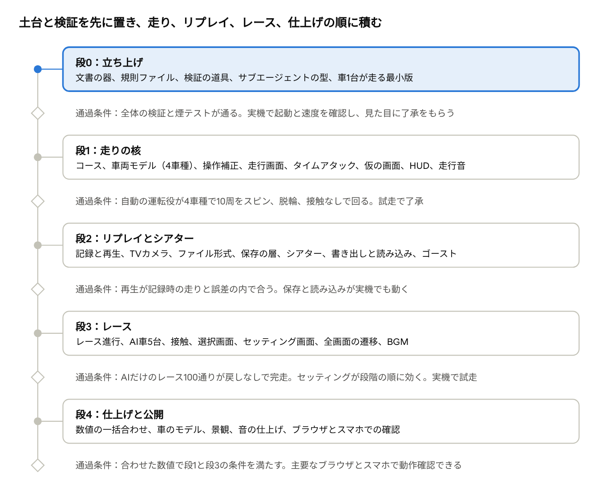

# CLIPPING POINT 開発計画

2026-11-11
開発はgame-dev-pilotの手順に沿って進めます。最初に土台と検証の仕組みを置く「立ち上げ」を行い、その後は機能を1段ずつ「設計、批評、確かめ、区切りの実装」の順で積みます。対象は、初期版（車4台、コース1本）のHTMLをお渡しするまでです。Webへの公開は別に決めます。

## 進め方

設計、実装、検証、記録はClaude Codeに任せ、game-dev-pilotの2つのモードを順に使います。

| モード | この計画での対応 | やること |
| --- | --- | --- |
| 立ち上げ | 段0 | 文書の器、短いCLAUDE.mdと分野ごとの規則ファイル、ロジックを切り離した土台、検証の仕組み、サブエージェントの型を、機能より先に置く |
| 段の進行 | 段1以降 | 機能を1段ずつ作る。1段は1〜4日、区切り2〜13本が目安 |

1段の中は次の順で進めます。

1. 設計の下書き。読み手が関わる領域の地図を作ってから、その段の設計を書く。
2. 批評。観点ごとのレビュー役と、指摘を疑って確かめ直す反証役を立てる。「詰み」は独立の観点にする。採否は主のエージェントが決めて設計を直す。
3. 確かめ。独立の目で、直した設計を見る。
4. 準備。手を入れる前のふるまいを写しで固めるコミットを置く。
5. 区切りの実装。実装、絞った検証、レビュー、直し、記録、コミットを1組とし、区切りの数だけ繰り返す。
6. 仕上げ。全体の検証を回し、文書と規則ファイルを整える。

進めるときの約束は次のとおりです。

- 1区切りは1コミット、1回のレビューとする。区切りの途中では止めず、検証、記録、コミットまで終えてから止める。やむを得ず途中でコミットしたときは、前の区切りの最後のコミットから、区切りの名を付けたコミットまでの差分をレビューの範囲にする。
- ふるまいを意図して変える区切りは、ロジックのコミットと、ふるまいの写しを取り直すコミットの2つで1組とする。
- 検証の報告は「回したもの（件数つき）」と「回せなかったもの・確かめられなかったこと」に分ける。0件や未評価を合格に数えない。
- 企画書は正本として扱う。実装とのずれは改訂案にため、反映は人が決める。採られた改訂案だけを正本に当てる。
- 車の性能、タイヤ、AIの強さ、操作補正の既定値は仮の値で作り、要素が揃ってから一度に合わせる。式の形、単位、段階の数はその場で決める。
- 伺いは方向に触れるものだけを、推奨つきの番号表で一度に行う。

設計時のドキュメントの3つのタブは、リポジトリに次の形で写してあります。

| タブ | リポジトリでの置き場 | 扱い |
| --- | --- | --- |
| 企画書 | `docs/canon/planning.md` | 正本。採られた改訂案だけを、Claudeが単独のコミットで当てる |
| 実装設計 | `docs/design/overview.md` | 全体の設計。段ごとの詳細設計は各段の開始時に `docs/design/` へ足す |
| 開発計画 | `docs/plan.md` | 段の並び。状態は作業記録に書く |

写した後は、3つともリポジトリの側を元とします。元のドキュメントは、着手時点の版として残します。

## 着手前に伺うこと

着手前に決めることは次の16項目です。2026年11月11日に、16項目すべてを推奨どおりとするご回答をいただきました。表の「推奨」の列が、決まった内容です。リポジトリは E-I-Show/clipping-point です。

まず、任せ方の方針です。一度決めれば、以後の伺いを減らせます。

| # | 決めること | 推奨 | 理由 |
| --- | --- | --- | --- |
| 1 | 判断の任せ方 | 細目は推奨で決めて進め、事後報告にする。遊び方や表示の方式のような方向だけ伺う | 細目を都度伺うと止まる時間が長い |
| 2 | 詰む所の直し | 走れない、進めないといった詰みは見つけた時点で直し、事後報告にする | 見つけた時点で直すほうが安い |
| 3 | 数値の合わせ | 車の性能、タイヤ、AIの強さ、操作補正の既定値は仮の値で作り、段4で一度に合わせる。式の形、単位、段階の数はその場で決める | 後から入る要素で釣り合いが変わる |
| 4 | 使用量で止める決まり | 区切りごとと、批評のような重い作業の前に、週の使用率を確かめる。週の経過の割合を上回っていたらその区切りで止め、予約した時刻に自動で再開する。着手の時点で上回っているときは、進めてよいかを伺う | 週の途中で使い切らない。使用率の得方は段0で確かめ、得られなければ区切りごとの消費量を作業記録に付けて節目で伺う |
| 5 | 進捗レポート | およそ1時間ごとに、進捗とスクリーンショットをリポジトリの `docs/reports/` に置いてpushする。区切りのコミットに同梱し、区切りが1時間を超えたときだけ単独でpushする | チャットを読まなくても進み具合が分かる |
| 6 | 判断のもらい方 | チャットの本文かMarkdownでいただく | 表計算のファイルは読めないことがある |

次に、土台の値です。後から変えると全体に響くので、ここだけは仮の値で進めません。

| # | 決めること | 推奨 | 理由 |
| --- | --- | --- | --- |
| 7 | 基準の解像度と拡大 | 320×240、整数倍拡大 | 企画書のとおり。変えるとHUDと全画面を作り直す |
| 8 | 時間の単位 | 1 tick = 1/60秒。描画は毎秒30回。リプレイの記録は3 tickごと | ご指示の「入力と物理は毎秒60回、描画は30 fps」に基づく |
| 9 | 数値の型 | 物理は浮動小数。保存する時刻は整数のtick、ラップタイムは整数のミリ秒、リプレイは量子化した整数 | 浮動小数の結果がデスクトップ版とブラウザ版で一致しない（実測） |

最後に、このプロジェクト固有のことです。

| # | 決めること | 推奨 | 理由 |
| --- | --- | --- | --- |
| 10 | リポジトリ | GitHubに `clipping-point`（非公開）を新しく作り、このセッションに接続していただく | コンテナは一時的で、残るのはpushしたgitだけ。このセッションに接続すれば、試作をそのまま退避できる |
| 11 | 作業ブランチ | 作業ブランチを1本に固定し、新しいセッションはそのブランチから始めていただく。段の終わりに既定ブランチへ入れる | セッションごとに別のブランチへpushすると、次のセッションに控えと決まりが届かない。実際の動きは段0で確かめる |
| 12 | 実機での確認のお願い | 段0から段4まで、各段の終わりに、生成したHTMLをPCのブラウザで開いていただく。段0は起動、画面に出る数字、走行画面の見た目の確認、段1以降は実物のコントローラーでの試走と試聴。HTMLはチャットにファイルとして送る | 実物のコントローラー、音、実機のブラウザはこの環境で確かめられない |
| 13 | GIF保存の扱い | 段2の最後にブラウザ版で実測し、負担が大きければ初期版では見送る。それまでは録画を切っておく | Pyxelの録画機能は、使うなら起動時から直近10秒分の画面を常に保持し、デスクトップ版の実測で約44 MBを使う。毎秒60回の設定では、10秒の録画が12秒かけて再生されるGIFになる |
| 14 | 音のチャンネル数 | 8チャンネルにする | 企画書の4チャンネルのままだと、リプレイ中にBGMを鳴らすためにスキールと効果音を落とすことになる |
| 15 | 初期版の逆走レイアウト | 入れない。初期版の後の段で追加する。コースデータ、保存の鍵、リプレイには、レイアウトの欄を最初から持たせる | 企画書は「初期版はアカネ・ショート1本」とだけ書いており、逆走を含むかが決まっていない。入れると、理想ライン、固定カメラ、看板の裏面が2通り要る |
| 16 | 公開する場所 | 初期版はHTMLファイルをお渡しするところまでとし、Webに置く場所は別に決める。スマホでの確認にはWebに置く必要があるので、段3の終わりまでに決めていただく | 置く場所によって、ブラウザ内保存の持ち主や、埋め込んだときの保存と入力の許可が変わる。決まった時点で、その形で保存と入力を確かめる |

## 段の並び

各段は通過条件を満たしてから次へ進みます。各段の通過条件には、実機での確認が入ります。段0は起動、速度、見た目の確認、段1以降は試走です。段4の終わりが初期版（車4台、コース1本）の公開です。

## 段0：立ち上げ

段0では機能を作らず、文書の器、決まりの器、検証の道具を先に置きます。最後に車1台が走る最小版を作り、ブラウザ版の速度と画面の方向を確かめます。道具と土台は、設計のために作った試作を元に組み直します。

| # | 区切り | 中身 |
| --- | --- | --- |
| 1 | 文書の器と試作の退避 | 正本の写し（伺いの回答を反映した版）、改訂案の置き場、作業記録、作業の控え、目次、言葉の表、初日のチェックリスト、短いCLAUDE.md（200行まで）の根。「割り切り」と「仮の値」の書き方。設計のための試作と実測の記録を、出荷物の外の `spikes/` へ退避する |
| 2 | 骨組みと道具 | `clipping_point/` の骨（`cp_core`、`cp_ui`、`cp_app`、`main.py`）と最小のメインループ（毎秒60回の更新、30 fpsの描画、裏画面）。check、test、run、export。層の分離の検査と、規則ファイルの見張り。道具をわざと壊して落ちることを確かめる |
| 3 | 環境とブラウザ版の煙テスト | 版を固定した依存の一覧、ランタイムの写しの取得と照合、環境のセットアップスクリプト。web-smoke（出荷するHTMLそのものを開く筋書き）、verify |
| 4 | Claude Codeの整え | サブエージェントの型3つ、禁止するgit操作の設定、作業の補助（使用率の得方、レビューの集計）、控えの差し込み、ブランチの決まり。置いた後にセッションを作り直し、新しいコンテナで全体の検証が通ることを確かめる |
| 5 | 入力の土台 | 入力フレーム、入力の注入。ブラウザ版の煙テストに、台本つきの筋書きと、偽のコントローラーを差し込む筋書きを足す |
| 6 | 画面の検査と巡回 | 2D描画を包む層、はみ出しの検査、スクリーンショットの巡回、画面の一覧と検査対象の突き合わせ |
| 7 | 保存と決定性の土台 | 保存の口（メモリ、ファイル、localStorage）、保存先が使えないときの切り替え（ブラウザ版の煙テストに、保存先に触れると例外になる筋書きを足す）、版の移行の口、用途別の乱数、指紋テストの形、保存して読み直すと一致するテスト |
| 8 | データの検査 | 定義データの読み込みと検査、試験用データの重ね方 |
| 9 | 縦切りのロジック | 仮の周回路の表と照会、車1台。画面なしで走らせて指紋を固める |
| 10 | 縦切りの描画と計測 | コースのメッシュ、後方追従の視点、夕方のパレット、左右が正しく写ることの判定。更新と実描画の時間を画面に出す表示。デスクトップ版とブラウザ版で処理時間を測る |

規則ファイルは、その分野の最初のファイルを作る区切りで足します。当て先の無い規則ファイルを先に置くと、見張りが落ちるためです。

通過条件は次の5つです。

- 全体の検証が通る。道具をわざと壊したときに落ちた記録が作業記録にある。
- ブラウザ版の煙テストで走行の場面を600 tick以上回し、更新が毎秒59回以上、実描画が毎秒29回以上、更新1回が4 ms以内、実描画1回が12 ms以内（95%点）である。これは開発環境のヘッドレスChromiumでの線で、単独で回したときの値で見ます。全体の検証の中で外れたときは単独で1度回し直し、それでも外れたら失敗とします。
- 縦切りのHTMLをPCのブラウザで開いていただき、起動すること、画面に出る更新と実描画の時間、読み込みにかかった時間を知らせていただく。走行画面の見た目の方向に了承をもらう。
- 新しいセッションで、控えと決まりとサブエージェントの型が見え、全体の検証が通る。
- 常設の方針（着手前に伺うことの回答）を、方法と理由の形で記録した。

game-dev-pilotの初日のチェックリストは、次のように区切りへ割り当てます。

| チェックリストの項目 | 区切り | このプロジェクトでの形 |
| --- | --- | --- |
| 正本の置き場と「Claudeは書き換えない」決まり、改訂案の置き場 | 1 | `docs/canon/` と `docs/proposals/`。採られた改訂案を当てるコミット以外では書き換えない。分かっている企画書とのずれを改訂案に起こす。1件目は、セッティング「ステアリング」の写し方 |
| 作業記録とdocsの目次 | 1 | `docs/worklog.md` と `docs/index.md` |
| 言葉の表 | 1 | `docs/glossary.md`。tick、段、区切り、セッティング、操作補正、アシストなど |
| CLAUDE.mdの根、規則ファイルの骨組み、見張りのテスト | 1、2 | 根は200行まで。規則ファイルは `.claude/rules/` に、分野の最初のファイルと一緒に足す |
| 割り切りの印の語と、仮の値の書き方 | 1 | コードの注とデータの注の書式を決める |
| 常設の方針を記憶に置く | 着手時、1 | 回答を `docs/standing-policy.md` に記録し、要点をCLAUDE.mdの根に置く |
| エンジンを参照しないロジックのライブラリと単体テスト。0件は失敗 | 2 | `cp_core`、`cp_ui` と `tests/` |
| ラッパー（check、test、run、export、editor） | 2 | editorは該当なし。Pyxelのエディタは使わない |
| ラッパーが本当に失敗を返すかを、わざと壊して確かめる | 2 | 構文エラー、テスト0件、例外、早すぎる終了、描画0回 |
| 乱数、時間の単位、数値の型 | 7 | 実装設計の「設計の前提」のとおり |
| セーブ（一時ファイルに書いて差し替え） | 7 | デスクトップ版の保存先。ブラウザ版はlocalStorage |
| 保存して読み直すと全項目が一致するテスト、保存しない項目の一覧 | 7 | 段0は設定が対象。記録とリプレイの棚は、作る段で対象に足す |
| データの読み込み検査と試験用データ | 8 | 知らない鍵と無い参照を弾く |
| 基準の解像度と拡大の方式 | 着手時 | 320×240、整数倍。伺いの7番 |
| はみ出しの検査とスクリーンショットの巡回 | 6 | 回り切れなければ失敗 |
| 開発用の橋 | 5、6、9 | 入力の注入と、テスト用の世界を準備する口 |
| 検証の2つの重さと、分野ごとに回す組の表 | 3 | 「検証の組」の章 |
| 作業の補助（`tools/claude/`） | 4 | 全体の検証を順に回す台本、使用率を得る台本、レビューの集計 |
| サブエージェントの型3つと報告の形 | 4 | 実装役、レビュー役、読み手。置いた後に最初の要求の重さを測る |
| 型を置いた後にセッションを作り直す | 4 | お願いする |
| 作業の控えとその差し込み | 1、4 | 控えは区切り1から置く。差し込みの仕掛けは区切り4 |
| 禁止するgit操作（強制push、`reset --hard`、`clean -f`） | 4 | `.claude/settings.json`。`git -C` を付けた形も禁じる |
| エクスポートの一周 | 2、3 | HTMLを作り、ブラウザ版の煙テストで起動を確かめる |
| Windowsの項目 | なし | 開発環境がLinuxなので該当なし |

## 各段の中身

段1から段4の目的、区切りの案、通過条件です。区切りは案であり、その段の設計と批評を経て確定させます。段0は前の章にあります。

### 段1：走りの核

目的は、アカネ・ショートを1台で走り、タイムを計れるようにすることです。手触りをここで固めます。

| # | 区切り | 中身 |
| --- | --- | --- |
| 1 | コースデータと照会 | アカネ・ショートの定義、中心線の表、位置から路面を引く照会、壁との当たり、周回判定とラップ計測、コース中央へ戻す位置の計算、読み込み検査、俯瞰図を出す道具 |
| 2 | コースの描画 | 路面、縁石、芝、壁のメッシュ生成。夕方のパレット、遠景、最小限の景観物 |
| 3 | 車両モデル | タイヤ、荷重移動、駆動系（ATの変速とターボを含む）、4車種の仮の値。加速、制動、定常円旋回のテスト。舵角をそのまま受ける口と、後輪ブレーキの倍率。目標のラップとの差をどこで埋めるかを決める |
| 4 | 入力と操作補正 | 入力の取り込み、アナログとデジタルの補正、アシスト、後退。自動の運転役で周回させる道具。指紋の台本を、運転役が走らせる形に作り替える。実装設計の「周回での確認と残る課題」に挙げた件を、4車種で試す。駆動の絞りの形の比較は、セッティングの写しがまだ無いので、LSDのロック率を直接振って行う |
| 5 | 走行画面 | 車の表示（1台分のモデル）、後方追従とバンパーの視点、車の影 |
| 6 | 仮の画面 | 仮のタイトル、車と変速とアシストの仮の選択、ポーズ、簡易リザルト。試走に要る入口だけを置き、段3で作り直す |
| 7 | タイムアタック | タイムアタックの開始から終了まで、ポーズメニューからコース中央へ戻す操作 |
| 8 | HUD | 速度、ギア、タコメーター、ラップ、コース略図 |
| 9 | MTとセッティングの写し | MTの変速、セッティング6項目の写し（画面は段3） |
| 10 | 操作設定 | 操作設定の画面と設定の保存 |
| 11 | 走行音 | エンジン音、スキール音、効果音。タブが隠れたときに音を止める処理 |

通過条件は次の4つです。

- デジタル入力だけを使う自動の運転役が、4車種それぞれで連続10周を、スピン、4輪の脱輪、壁への接触、コース中央へ戻す操作のどれも0回で回る。アナログ入力の運転役も同じ条件で回る。
- 運転役の条件は固定する。グリップの約7割を使う控えめな設定、アシストON、AT、標準のセッティング、乱数の種3つ以上とし、平均ラップが、その車の値で計算した理想のラップの1.27倍以内であること。遅く走らせるだけで通るのを防ぐ線で、試作の運転役（グリップの約72%）は4車種とも1.18〜1.23倍だった。反応の遅れ、判断の刻み、スピンと脱輪を数える線は段1の設計で決め、以後は変えない。試作では、車体の滑り角が約40度を超えたらスピン、車の中心が舗装の端から0.85 mを超えて外へ出たら4輪の脱輪と数えた。反応の遅れ、手のぶれ、判断の刻みは、試作の値（0.1秒、3%、デジタルは7 tickごと）より甘くしない。応答カーブは直線にして回す。試作の時点では、アナログはスピン、4輪の脱輪、壁への接触が全車0回。デジタルはシロガネが0回、カザネは9周でスピン2回、4輪の脱輪1回、コース中央へ戻した1回、FF車と4WD車は9周で5〜7回の脱輪が残っている。
- アナログコントローラーとキーボードの両方で試走していただき、手触りの方向に了承をもらう。走行中にタブを切り替えると音が止まり、戻るとポーズになっていることも確かめていただく。
- ブラウザ版の煙テストで、段0と同じ処理時間の線を保つ。

運転役の条件を3巡直しても満たせないときは、止めて方向を伺います。

### 段2：リプレイとシアター

目的は、走りを記録して観返し、保存して後から読み込めるようにすることです。

| # | 区切り | 中身 |
| --- | --- | --- |
| 1 | 記録 | 毎秒20回の記録、量子化、直近5周を残す輪 |
| 2 | 再生の部品 | 補間、任意の時刻への移動、巻き戻し、速度変更。再生した姿勢、周回、順位を記録時の値と比べるテスト |
| 3 | リプレイ画面 | 後方追従とバンパーのカメラ、再生操作、HUDの切替。簡易リザルトからの入口 |
| 4 | TVカメラとヘリ | コースの固定カメラの定義、自動切替、ズーム |
| 5 | ファイル形式 | `.cpr` の書き出しと読み込み、検査、壊れたファイルの扱い |
| 6 | 保存の層 | デスクトップ（ファイル）とブラウザ（localStorage）、上限と入れ替え、書き込みに失敗したときの書き出しの案内 |
| 7 | シアター画面 | 一覧、並べ替え、名前変更、削除。仮のタイトルからの入口 |
| 8 | 書き出しと読み込み | ダウンロード、ドロップ、ファイル選択 |
| 9 | ゴースト | ベストラップの切り出しと並走、シアターからの「ゴーストに設定」 |
| 10 | GIF保存 | 再生中の直近10秒を保存。実測して、載せるかを決める |

通過条件は次の3つです。

- 実際の車両モデルで走らせた記録を再生し、位置と向きが記録時の状態と決めた誤差の内に収まる。書いて読んで一致するテストと、壊したファイルを弾くテストが通る。
- ブラウザ版の煙テストで、保存、ページの再読み込み、棚からの再生、書き出し、ドロップでの読み込みが通る。
- 実機で、キーボードとコントローラーのそれぞれの操作からファイルの選択と書き出しができ、ページを開き直しても棚に残ることを確かめていただく。手元のファイルとして開くと保存が残らないブラウザでは、そのことが画面に出て、ファイルへの書き出しと読み込みで戻せることを確かめていただく。スマホでの読み込みは段4で確かめる。

### 段3：レース

目的は、AI車5台と順位を争うシングルレースと、タイトルからリザルトまでの全画面をつなぐことです。

| # | 区切り | 中身 |
| --- | --- | --- |
| 1 | レース進行 | グリッド、カウントダウン、順位、フィニッシュ |
| 2 | AI | 理想ラインの追従、強さ3段階、前の車を避ける最小限の動き、動けないときの自動復帰。AIだけのレースを回す道具 |
| 3 | 車同士の接触 | 押し戻しと減速。前走車の真後ろで空気抵抗が減る処理 |
| 4 | 選択画面 | 車、色、コース、周回数、AIの強さ |
| 5 | セッティング画面 | 6項目、4本バー、おまかせ、車×コースごとの記憶 |
| 6 | 画面のつなぎの仕上げ | 仮の画面を置き換え、タイトルからリザルトまでをつなぐ |
| 7 | 6台のリプレイ | 注目する車の切替、順位の表示 |
| 8 | 記録の保存 | ベストラップと最高順位 |
| 9 | 音の追加 | 他車のエンジン音、BGM |

通過条件は次の3つです。

- AIだけの5周レースを、乱数の種、強さ3段階、クラス2つを変えた100通りで回し、全車が完走する。自動でコースへ戻した回数が0回であること。自車の枠もAIが運転する。
- セッティングの各項目を段階の順に振ると、実装設計の車両モデルの章で項目ごとに決めた量が段階の順に並ぶ。
- 6台のレースを実機で試走していただき、処理が間に合っていることを確かめていただく。

### 段4：仕上げと公開

目的は、数値と見た目と音を仕上げ、初期版のHTMLを出すことです。

| # | 区切り | 中身 |
| --- | --- | --- |
| 1 | 数値の一括合わせ | 4車種の性能、タイヤ、AIの強さ、操作補正の既定値 |
| 2 | 車のモデル | 残り3台のモデルとボディカラー |
| 3 | コースの景観 | スタンド、看板、ピット棟、木、遠景 |
| 4 | 音の仕上げ | エンジン音の車種差、効果音、BGM 3曲 |
| 5 | ブラウザとスマホの確認 | 主要なブラウザ、画面上パッド、HTMLの大きさ |
| 6 | 通しのテストと仕様書 | 長時間の自動走行、保存と読み込みの通し、いまの姿をまとめた仕様書 |

通過条件は次の3つです。

- 数値を合わせた後の値で、段1と段3の通過条件を測り直して満たす。
- HTML 1本を主要なブラウザとスマホで動作確認できる。実機のブラウザとコントローラーでの確認はお願いする。
- 全体の検証がすべて通る。

初期版の後に、追加の車2台、コース2本、逆走レイアウトを1段として足します。

## 検証の組

検証は2つの重さで回します。ただし全体の検証が3分を超えるまでは、どの区切りでも全体を回します。試作の規模では全体が13秒でした。

|  | 絞った検証 | 全体の検証 |
| --- | --- | --- |
| いつ | ふつうの区切り | 段の仕上げ、土台に触れたとき、絞った検証を3回重ねたとき |
| 中身 | check、触れた分野のテスト、その分野に決めた手順 | check、test、fingerprint、screen-check、run、tour、drive（短い版）、race-sim（短い版）、音の回帰、export、web-smokeを決まった順に全部。段の仕上げではselftest-breakも回す |
| 報告 | 回したもの（各道具の最後の1行）と、回せなかったものを分けて書く | 同じ |

運転役の周回（drive）とAIだけのレース（race-sim）には、短い版と長い版を持たせます。短い版は全体の検証に入れます。通過条件を測る長い版は、段の仕上げと、下の表で指定した分野に触れた区切りで回します。

分野ごとに回す組は次のとおりです。触れた分野は申告ではなく、変更したファイルから `tools/verify` が引きます。出荷するコードとテストのすべてのファイルが、どれかの分野か「全部」に当たることをcheckで見張ります。セッティングの順のテストは、操作補正を通して測る分を含むので、車両と操作補正のどちらに触れても回します。

| 触れた分野 | テストの絞り | 足す手順 |
| --- | --- | --- |
| 車両 | 車両、世界、指紋、セッティングの順 | run、run-drive、run-wall、drive |
| コース | コース、世界、指紋、データ | run、run-drive、run-wall、tour、drive |
| 操作補正と入力 | 操作補正、保存する項目、セッティングの順 | run、run-drive、run-wall、drive、web-smoke |
| AI | AI、世界、指紋、乱数 | run、race-sim |
| レース進行 | レース、世界、指紋 | run、screen-check、race-sim |
| 描画 | 画面 | run、tour、web-smoke |
| カメラと画面の状態 | カメラ、画面の状態、指紋 | run、screen-check |
| リプレイ | リプレイ、保存、指紋 | run、web-smoke |
| 画面（2D） | 画面 | screen-check、tour |
| 音 | 音、データ | run、音の回帰、web-smoke |
| ブラウザ連携（入力の直読み、保存先、ファイルの受け渡し） | 保存 | web-smoke |
| 保存、データの検査、乱数、メインループ、世界の状態 | 全部 | 全体の検証 |
| 検証の道具、検査の決まり（はみ出しの検査、データの検査、見本データ） | 全部 | 全体の検証とselftest-break |

この表は `tools/verify` の1か所にだけ書きます。CLAUDE.mdには表を出すコマンドだけを書き、組み立てを2か所に持ちません。

ほかに次を決まりにします。

- 新しい検証を足す区切りでは、わざと壊して落ちる件を一緒に足す。
- ブラウザ版のPython（3.14）でだけ起きる違いは、ブラウザ版の煙テストで拾う。批評の中で、試作のロジックのテスト45件を3.13と3.14で回し、同じ結果になった。
- ブラウザ版の煙テストは、出荷するHTMLそのものを開く筋書きを必ず1本持つ。

## 文書とClaude Codeの構成

文書は役目ごとに分け、決まりは短いCLAUDE.mdと分野ごとの規則ファイルに置きます。常に読まれる量を小さく保つためです。

| 文書 | 置き場 | 役目 |
| --- | --- | --- |
| 正本 | `docs/canon/planning.md` | 企画書。写した後はここを元とする。人が採った改訂案だけを、番号を添えた単独のコミットで当てる。それ以外の変更は、内容の要約値の写しで見張る |
| 改訂案 | `docs/proposals/` | 正本とのずれ、方向を決める材料、急がない案。反映は人が決める |
| 全体の設計 | `docs/design/overview.md` | 実装設計タブの写し |
| 段ごとの設計と批評 | `docs/design/` | 段の開始時に書く。頭に2〜3行の要約を置く |
| 開発計画 | `docs/plan.md` | 開発計画タブの写し |
| 作業記録 | `docs/worklog.md` | 頭に状態の表。決めた細目、検証の行、事後報告、次の手 |
| 作業の控え | `docs/handoff.md` | 25行まで。区切りのコミットと一緒に上書きする |
| 常設の方針 | `docs/standing-policy.md` | 伺いの回答を、方法と理由の形で書く。要点はCLAUDE.mdの根にも置く |
| 言葉の表、目次 | `docs/glossary.md`、`docs/index.md` | 同じ語を別の意味で使わない。各文書の1行と状態 |
| 進捗レポート | `docs/reports/` | およそ1時間ごとの進捗とスクリーンショット |

game-dev-pilotは作業の控えと記憶をgitの外に置く前提ですが、この環境はコンテナが一時的なので、次のように変えます。

- 作業の控えと常設の方針はリポジトリに置く。
- 区切りの終わりを「コミットしてpushするまで」とする。pushしていない作業は無いものとして扱う。
- 作業ブランチは1本に固定する。セッションの開始時に、控えより新しいコミットを持つ別のブランチが無いかを確かめる。
- セッションの開始時に控えを差し込む仕掛けを置く。新しいコンテナでは数行の案内だけ、圧縮や再開の後は全文を出す。
- Pyxelとテストの道具は版を固定し、ブラウザ版ランタイムの写しと一緒に、環境のセットアップスクリプトで入れる。スクリプトの登録には承認をお願いする。
- この環境は、未コミットの変更を残してターンを終えようとすると、コミットとpushを促す。区切りの途中でターンを終えるときは途中のコミットを許し、区切りの名を付けた最後のコミットをレビューの単位にする。

CLAUDE.mdの根は200行までとし、いちばん大事な約束、常設の方針の要点、コマンドの表、ディレクトリの表、土台の方針、規則ファイルの目次だけを置きます。分野にだけ効く決まりは規則ファイルへ置きます。

| 規則ファイル | 当てる所 |
| --- | --- |
| vehicle | 車両モデル、車の定義データ、そのテスト |
| track | コースの表と照会、コースの定義データ |
| controls | 操作補正、その定義データ、入力の取り込み |
| ai | AIの運転、その定義データ |
| race | レース進行 |
| sim-core | 乱数、描画の間引き、世界の状態、指紋の写し |
| replay | 記録、再生、ファイル形式 |
| save | 保存の口、保存する項目、ブラウザの保存先 |
| data | 定義データの検査、試験用データ |
| ui | 2Dの画面の組み立てと検査 |
| render | 3Dの描画、パレット |
| audio | 音の要求と再生、音の定義データ |
| web | ブラウザ連携、ブラウザ版の検証道具 |
| tools | 検証の道具 |

多くの分野が触るファイル（起動スクリプトとメインループ）は、どの規則ファイルにも当てません。規則ファイルの当て先が空振りしていないか、大きさが上限の内か、目次と対応しているかは、テストで見張ります。

サブエージェントの型は3つ置きます。

| 型 | 役目 | このプロジェクトでの約束 |
| --- | --- | --- |
| 実装役 | 設計の1区切りを実装し、絞った検証を回して報告する | コミットもpushもしない。検証は道具だけを1本ずつ回す。写しの取り直しは頼まれたときだけ |
| レビュー役 | 与えられた観点で設計か差分を読み、起きる場合を添えて指摘する | 読むだけ。道具もテストも回さない |
| 読み手 | コードや文書を読んで、領域の地図や要約を返す | 何も書き換えない |

レビュー役の観点には、このプロジェクト固有のものを足します。

- Pyxelや実時間がロジックの層に届いていないか。
- 描画命令を通さない2Dの描画が無いか。
- 新しいコードが既存の乱数の流れを引いていないか。
- ロジックの変更と同じコミットで、ふるまいの写しが書き換わっていないか。
- 何も調べずに合格で終われる道具になっていないか。
- ブラウザ版が通る道に、デスクトップ版でしか動かないコードが無いか。

設定では、強制push、`reset --hard`、`clean` など戻せないgit操作を禁じます。作業ディレクトリを指定する形（git -C）も含めます。禁止の書式と、控えを差し込む仕掛けは、実際のセッションではまだ確かめていません。段0で小さく試してから入れます。

## 環境の前提

開発はこのクラウド環境（Linuxのコンテナ）で進められます。着手前にお願いしたいのは、リポジトリの用意です。段0の途中で、環境のセットアップスクリプトの承認と、新しいセッションの開始をお願いします。

| 項目 | 状況 | お願いすること |
| --- | --- | --- |
| リポジトリ | まだ無い。コンテナは一時的で、残るのはpushしたgitだけ。今回の設計作業中にも再起動が1回起き、実行中の調査が止まった | GitHubに新しいリポジトリ（非公開でよい）を用意し、このセッションに接続していただく |
| Pyxelとブラウザ版ランタイムの写し | Pyxelは `pip install pyxel==3.0.1` で入る。ランタイムの写しはGitHubとnpmから取得でき、ヘッドレスのChromiumで実際に動く（確認済み）。配信元のkitao.devにはこの環境から届かないが、検証には要らない | 新しいコンテナにも入るよう、段0でセットアップスクリプトを用意する。登録のときに承認をお願いする |
| 実機での確認 | 実物のブラウザ（Chrome、Firefox、Safari）、実物のコントローラー、スマホ、音は、この環境では確かめられない | 各段の終わりに、生成したHTMLでの確認をお願いする。段0は起動、数字、見た目の確認 |
| セッション | サブエージェントの型は、置いた後にセッションを作り直すまで使えない | 段0の途中で1度、新しいセッションを始めていただく |
| 試作の保全 | 設計のための試作はこのセッションの作業用の置き場にあり、コンテナが替わると消える。一式はファイルでお渡ししてある | リポジトリの接続後、最初のコミットで `spikes/` へ退避する |

## リスクと見直す条件

この計画が前提にしていることと、それが崩れたときの動きです。兆しが出たら、その区切りの終わりに作業記録へ書き、方向に触れるものは伺います。

| リスク | 兆し | 動き |
| --- | --- | --- |
| デジタル操作で走りが成り立たない | 段1で、デジタル入力の運転役が通過条件（スピン、4輪の脱輪、壁への接触、コース中央へ戻す操作が0回）を満たせない。試走で「慣れても走れない」と感じる | 車の値（グリップ、FR車の滑りやすさ）、補正の既定値、コース（幅、ヘアピンの半径）の順で直す。通過条件を満たすまで段2へ進まない |
| 実機で処理が間に合わない | 段0の試走で、更新1回が4 ms、実描画1回が12 msを超える。毎秒30回の描画を保てない | 景観と遠景のポリゴン数、他車の台数（6台から4台）の順で減らす |
| 実物のコントローラーが想定と違う | 軸やトリガーの並びが合わない。トリガーがアナログ値を返さない | 割り当ての選択肢を操作設定に足す。段1の操作設定の区切りで扱う |
| 見た目の方向が合わない | 段0の縦切りの画面を見て了承が出ない | 段1に入る前に、路面と車の見た目だけをやり直す区切りを足す |
| エンジン音がそれらしく聞こえない | 段1の試聴 | 音符の長さの切り替え、波形の差し替えを試す。決まらなければ仮の音で先へ進み、段4で仕上げる |
| ブラウザ内保存の容量や持続がブラウザごとに違う | 段2の試走で、保存したリプレイが消える、入らない | 棚の上限を下げ、ファイル書き出しを主な保存手段にする |
| GIF保存の負担が大きい | 段2の最後の実測で、メモリか処理時間を圧迫する | 初期版では見送る（伺いの13番） |
| Pyxelの不具合に当たる | Pyxel Cubeか音で、再現する不具合が出る | 3.0.1のまま回避する。版を上げるのは段の切れ目だけにし、全体の検証と指紋の取り直しを単独のコミットで行う |
| コンテナの再起動で作業を失う | 設計作業中に1度起きた | 区切りの終わりを「pushするまで」とし、控えをリポジトリに置く。長い作業は区切りを細かくする |
| 使用量が足りなくなる | 区切りの終わりに、週の使用率が週の経過の割合を上回る | その区切りで止める（伺いの4番）。次からレビュー役の数を絞る |
| 検証が重くなる | 全体の検証が3分を超える | ふつうの区切りは絞った検証に切り替え、全体は段の仕上げと土台に触れたときに回す |
| 段が見積りより大きい | 1段の区切りが13本を超える、または4日で終わらない | 段を2つに割り、前半だけで通過条件を置き直す |
| 数値合わせが収束しない | 段4で、目標のラップ（クラスA約1分、クラスB約1分5秒）に合わない | 車のグリップ、コーナーの半径、全長の順に動かす |

計画そのものを見直す節目は4つです。

1. 段0の終わり。実機での速度と、見た目の方向が分かる。描画の規模をここで確定する。
2. 段1の終わり。手触りが分かる。了承が出なければ、段2へ進まずに車の値と操作補正をやり直す。
3. 段2の終わり。保存と読み込みが実機で動くかが分かる。GIF保存の扱いを決める。
4. 段4の数値合わせの後。初期版としてお渡しするか、もう1巡調整するかを決める。
