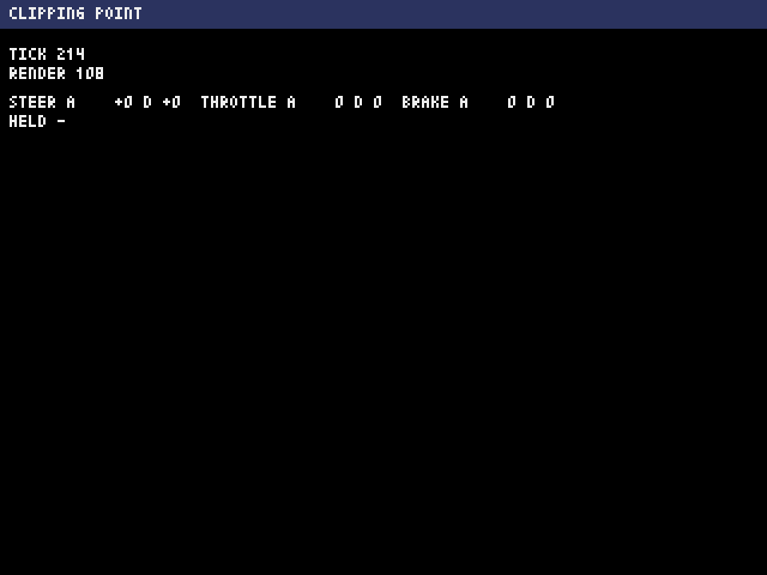

# 進捗レポート 2026-11-11 05

> 要約：段0の区切り5（入力の土台）を終えた。段0は10区切りのうち5つまで済んだ。キーボードとコントローラーの入力が、決まった形（入力フレーム）になって世界へ届くようになり、ブラウザ版で、作り物のコントローラーを差し込んで確かめる仕組みができた。次は区切り6（画面の検査と巡回）。

## 前回からの進捗

- 区切り5を終えた。
  - 入力フレーム（舵、アクセル、ブレーキのアナログ値とデジタル値、10個のボタンの「押している」と「押した瞬間」）を決めて作った。舵は、左が正。
  - 入力アダプタが、キーボードとコントローラーを、正本の操作の表のとおりに読む。メニュー操作の割り当て（決定、戻る、上下左右）は、細目として決めた。
  - ブラウザ版では、トリガーの踏み込みの量を、ブラウザから直に読む（Pyxelを通すと、0か最大かでしか届かないため）。
  - 台本（決まった入力の列）を差し込んで回せるようになった。デスクトップ版とブラウザ版で、同じ台本から同じ結果になることを見ている。
  - ブラウザ版の煙テストに、筋書きを2本足した（台本つき、偽のコントローラー）。偽のコントローラーは、未接続、接続、トリガーを0.3と1.0に、スティックとボタン、押したまま切断、標準でない並び、の順に見せる。
  - 仮の表示に、入力の値を出す2行を足した（下の画像）。実機で、実物のコントローラーの値を見ていただくための表示。
- 進め方を1つ足した：実装の前に、頼みの文そのものをレビューにかける。今回は、指摘8件が通り、作ってからでは見つけにくい穴を2件、先に塞げた。

## コミット

| ブランチ | 題 |
| --- | --- |
| `dev` | 段0 区切り5（途中）：…（7つ。ターンの終わりごとに、未コミットの変更をコミットする決まりのため） |
| `dev` | 段0 区切り5：入力の土台 |

## 検証の数

主が、直しの後に回し直した結果（`python3 tools/verify.py --all --selftest`。約10分半）。

| 道具 | 結果 |
| --- | --- |
| check | 合格。構文53ファイル、層の分離8ファイル、規則ファイル5つ、正本1つ、分野の見張り38ファイル |
| test | 合格。899件（前回は376件） |
| run | 合格。速い経路（台本を渡す）と、本番と同じ経路（入力アダプタから読む） |
| export | 合格。HTMLは37,183バイト |
| web-smoke | 合格。筋書き4本。660 tickで、更新が毎秒60.0回、実描画が毎秒29.95回。更新1回は0.4 ms（95%点。線は4 ms） |
| selftest-break | 合格。163件（壊す件145、壊さない件18） |

レビューは、頼みの文が2体（指摘8件、反証を通った8件）、区切りが8体（指摘16件、反証を通った7件。重さが高の指摘は無い）。通った指摘は、すべて直した。結果は `docs/reviews/stage0-k5-request.txt` と `docs/reviews/stage0-k5.txt` にある。

## 画面

ブラウザ版（ヘッドレスのChromium）で、何も渡さずに開いた画面。主が見た1枚。何も押していない状態。

## 実測で分かったこと

- ブラウザ版では、コントローラーをつないだ後の最初のスティックの変化が、Pyxelへ届かない（偽のコントローラーでの実測。主も再現した）。実物のスティックは値が続けて変わるので、落ちるのは最初の1つだけ、と見ている。実機では確かめていない。
- 入力を入れて、ブラウザ版の更新1回の時間が、0.1 msから0.4 msに増えた。線（4 ms）の1割。扱いは、走行の場面で測る区切り10で決める。
- 押したままコントローラーを抜くと、次のtickで、全部の値が0へ戻る。
- コントローラーを1台だけつないだときは、どのコントローラーの枠に入っても、舵とトリガーが同じ機器から読まれる（主の実測）。2台以上は確かめていない。

## 確かめられていないこと

- 実機（実物のコントローラー、実物のブラウザ、画面上パッド）。
- デスクトップ版のスティック、トリガー、キーボードの読み方は、偽のPyxelを使ったテストだけ（画面なしでは、実物の機器が読まれない）。
- 入力の値が入った状態の画面は、画像に残っていない。仮の表示の2行が、実際の画素として動くことは、区切り6の巡回から見る。

## 次の手

- 区切り6：画面の検査と巡回。読み手に試作を読ませてあり、頼みの文の下書きまで済んでいる。頼みの文をレビューにかけてから、実装役に頼む。
- 段0の終わりの、実機での確認で見ていただくこと：コントローラーをつないで、最初にスティックを倒したときに、舵の値が動くか。トリガーの値が、踏み込みに合わせて変わるか。

## 使用量

- 週の使用率は46%（2026-11-11 15:57 UTC。2つある週の枠の高いほう。もう一方は43%）。
- 区切り5の全部（読み手2体、頼みの文のレビュー2体、実装役の実装と直し、区切りのレビュー8体、主の作業）で、約16ポイントを使った。うち、区切り6の準備の読み手が約1ポイント。
