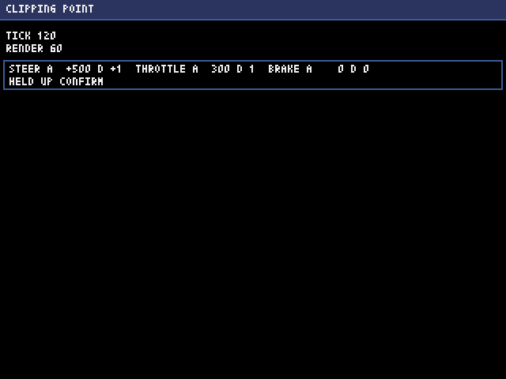
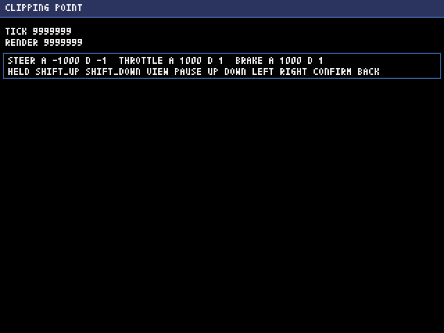

# 進捗レポート 2026-11-11 06

> 要約：段0の区切り6（画面の検査と巡回）を終えた。段0は10区切りのうち6つまで済んだ。2Dの画面を、機械が検査できるようになった（はみ出しの検査と、画像を保存して画素と照らす巡回）。次は区切り7（保存と決定性の土台）。

## 前回からの進捗

- 区切り6を終えた。
  - 2Dの描画命令に、縁だけの矩形、線、囲みを足した。囲みは、パネルや行のまとまりを宣言するもので、中の文字が囲みの外へ出たら、はみ出しとして数える。
  - はみ出しの検査を作った。数えるのは6種類（空の矩形、画面の外、囲みの外、出せない文字、文字どうしの重なり、開かれなかった囲み）。
  - 見本データを作った。画面を、ふつうの値と、極端な値（いちばん長い文字、いちばん大きい数）の両方で組み立てる。
  - 道具を2本足した。screen-check は、全部の画面を見本データで組み立てて、はみ出しを数える。tour（巡回）は、各画面の画像を保存し、描画命令の1つずつについて、実際の画素が、命令の矩形の内にだけあることを照らす。
  - 文字の大きさの式（1字が幅4、高さ6のセルで、画素を置くのはその内側）が、実物の画素と合うことを確かめた。
- 区切り7の準備をした（読み手に試作を読ませ、頼みの文の下書きを書いた）。

## コミット

| ブランチ | 題 |
| --- | --- |
| `dev` | 段0 区切り6（途中）：…（6つ） |
| `dev` | 段0 区切り6：画面の検査と巡回 |

## 検証の数

主が、直しの後に回し直した結果（`python3 tools/verify.py --all --selftest`。約13分半）。

| 道具 | 結果 |
| --- | --- |
| check | 合格。構文64ファイル、層の分離11ファイル、規則ファイル5つ、正本1つ、分野の見張り47ファイル |
| test | 合格。1,138件（前回は899件） |
| screen-check | 合格。2件（1画面×2変種）。はみ出し0 |
| run | 合格。速い経路と、本番と同じ経路 |
| tour | 合格。画像2枚、照らした命令16個。問題0 |
| export | 合格。HTMLは54,243バイト |
| web-smoke | 合格。筋書き4本 |
| selftest-break | 合格。214件（壊す件190、壊さない件24） |

レビューは、頼みの文が2体（指摘8件、反証を通った6件）、区切りが6体（指摘15件、反証を通った7件。重さが高の指摘は無い）。通った指摘は、すべて直した。結果は `docs/reviews/stage0-k6-request.txt` と `docs/reviews/stage0-k6.txt` にある。

## 画面

巡回が保存した画像（デスクトップ版。画面の2倍）。主が2枚とも見た。帯、帯の下の線、状態の2行、縁だけの矩形の中の入力の2行が、隠れずに出ている。

ふつうの値：

極端な値（tickが7桁、舵が負、ボタン10個）：

## 途中で起きたこと

- 実装役の、直しの後の全体の検証が、1回目だけ落ちた。落ちたのは、ブラウザ版の実描画の回数（660 tickで317回。通る幅は318〜342回）と、時間に頼る壊さない件2つ。その回は全体に遅く、機械が込んでいた、と見ている（原因は突き止めていない）。ファイルを変えずに回し直した回と、主の回し直しは通った。時間に頼る確かめは、機械が込むと、コードと関係なく落ちることがある。決まりのとおり、単独で1度回し直して見る。

## 確かめられていないこと

- 巡回が実物の画素と照らすのは、いまの画面で使っている命令だけ（斜めの線、複数行の文字、g j p q y を含む文字、色0の命令は、いまの画面に無い）。
- 描く順の誤り（文字が、後から描いた下地に隠れる）は、機械では拾えない。画像を目で見て拾う。
- 色の番号がパレットの内にあることは、まだ見ていない（パレットを決める区切り10で足す）。
- ブラウザ版では、巡回は動かない（デスクトップ版だけの口）。

## 次の手

- 区切り7：保存と決定性の土台（保存の口と3つの保存先、保存先が使えないときの切り替え、形式の版と移行、設定の往復のテスト、用途別の乱数、指紋のテストの形）。頼みの文をリポジトリに置き、レビューにかけてから、実装役に頼む。

## 使用量

- 週の使用率は61%（2026-11-11 18:54 UTC。2つある週の枠の高いほう。もう一方は51%）。
- 区切り6の全部（頼みの文のレビュー2体、実装役の実装と直し、区切りのレビュー6体、主の作業）で、約12ポイントを使った。ほかに、区切り7の準備の読み手が約1ポイント。
- このセッションの開始（30%）から、31ポイント。残りの4区切りを同じ調子で進めると、区切り8の途中で90%の線に届く見込み。
