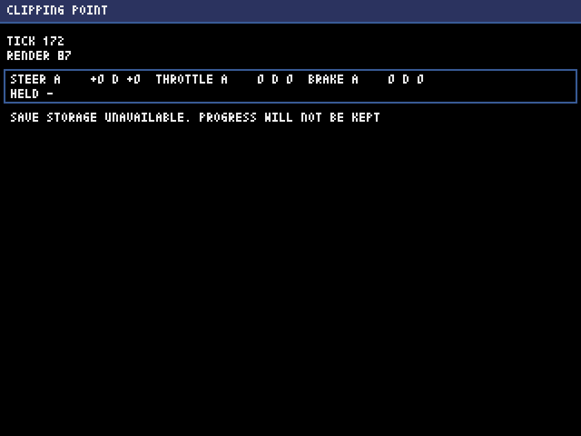
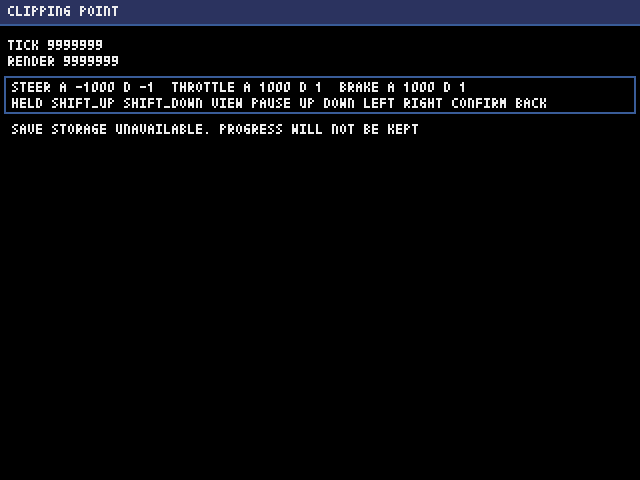

# 進捗レポート 2026-11-11 07

> 要約：段0の区切り7（保存と決定性の土台）の途中。頼みの文をレビューで確かめて直し、実装役の実装が入った。主の検証は回し直している所で、区切りのレビューは、これから。段0は10区切りのうち6つまで済んでいる。

## 前回からの進捗

- 区切り7の頼みの文を、実装の前にレビューで確かめた（2体）。指摘13件のうち、反証を通った10件を、頼みの文に反映した。
  - いちばん重かった指摘：localStorage に読めない値があると、読み込みが例外を出して、ブラウザ版が起動のたびに止まる道があった。読み込みは例外を外へ出さない形に決め直した（場合ごとの扱いを、7行の表にした）。
  - ほかに決め直したこと：保存の往復は、ふつうの設定の鍵に触れない別の名前空間で回す。新しい形式バージョンの値を上書きしない守りは、保存の口の書き込みの側に置く。世界の要約は、入れ子にしない。ふるまいの写しを取り直す口は、1つにする。
- 区切り7の実装が入った（実装役。約92分）。
  - 保存の口と、3つの保存先（メモリ、ファイル、localStorage）。値には封筒（印、形式バージョン、長さ、チェックサム）を付ける。
  - ブラウザ版は、起動時に試し書きをして、localStorage が使えなければ、メモリへ切り替えて、画面に1行で知らせる。
  - 保存する項目は、いまは設定の6項目（音量2つ、変速、アシスト、視点、レースの通し番号）。壊れた値は、別の鍵へ退避してから、既定値で書き直す。新しい形式バージョンの値は、上書きしない。
  - 乱数（用途別の流れと、ハッシュの抽選）。世界は種を受けて、要約に、種と流れの状態を入れる。
  - 道具を1本足した。fingerprint は、決まった筋書きで世界を回した要約（指紋）と、保存する項目の一覧を、ふるまいの写しと照らす。
  - ブラウザ版の煙テストに、保存先に触れると例外になる筋書きを足した（5本になった）。
- 区切り8（データの検査）の細目の案を作った（実装役の待ちの間に、主が試作を読んだ。作業記録の「次の手」）。

## コミット

| ブランチ | 題 |
| --- | --- |
| `dev` | 段0 区切り7（途中）：頼みの文と、言葉の表の4語 |
| `dev` | 段0 区切り7（途中）：頼みの文のレビューの指摘10件の反映 |
| `dev` | 段0 区切り7（途中）：実装役の実装（主の検証と、区切りのレビューの前） |

## 検証の数

実装役の回（`python3 tools/verify.py --all --selftest`。1,194.6秒）。主の回し直しの結果は、この表の下に書く。

| 道具 | 結果 |
| --- | --- |
| check | 合格。構文78ファイル、層の分離14ファイル、規則ファイル6つ、正本1つ、分野の見張り62ファイル |
| test | 合格。1,581件（前回は1,138件） |
| fingerprint | 合格。筋書き2本、保存する項目6つ。環境の値は、写しと同じ |
| screen-check | 合格。2件（1画面×2変種）。はみ出し0 |
| run | 合格。速い経路と、本番と同じ経路。保存先はファイル |
| tour | 合格。画像2枚、照らした命令17個。問題0 |
| export | 合格。HTMLは81,043バイト（前回は54,243バイト） |
| web-smoke | 合格。筋書き5本。更新1回は0.4 ms（95%点。線は4 ms） |
| selftest-break | 合格。262件（壊す件232、壊さない件30） |

主の回し直し（21:18〜21:38 UTC。1,174.4秒）：10手順とも合格。件数は、実装役の回と同じ（テスト1,581件、壊す件262件、筋書き5本）。ブラウザ版は、更新が毎秒60.0回、実描画が毎秒30.05回、更新1回が0.4 ms、実描画1回が0.3 ms（95%点）。時間に頼る確かめは、落ちなかった。

## 画面

主が4枚を見た（巡回の2枚と、煙テストの2枚）。知らせの1行は、入力の囲みの下に出ていて、重なりは無い。知らせが無いときは、行ごと出ない。

ブラウザ版で、保存先に触れると例外になるようにして開いた画面（メモリへ切り替えて、1行で知らせている）：

巡回の、極端な値（いちばん長い知らせの文）：

## 途中で分かったこと

- ブラウザ版で、`localStorage` に触れると例外になるとき、Pythonから見える例外の名は、投げられた物の作りで変わる（`SecurityError` のことも、`Error` のこともある）。切り替えの判定は、型にも名にも頼らず、「容量超過か、そのほかか」だけを見る形にした。
- ハッシュの抽選は、ブラウザ版では1回3〜9マイクロ秒かかる（デスクトップ版は1〜3マイクロ秒）。毎tickの内側では呼ばない決まりにした。
- 道具をわざと壊す確かめ（selftest-break）が、約12分半から約19分に伸びた。全体の検証を丸ごと回す件が6件あり、1件が約65秒かかる。縮めるかは、区切り8で決める。
- 規則ファイル6つのうち5つが、大きさの上限（6,000バイト）の間際になった。上限は仮の値なので、区切り8の頭で、上げるか、分けるかを決める。

## 確かめられていないこと

- ブラウザが自分で投げる本物の例外（保存先に触れられない設定のブラウザ）の、Pythonからの見え方。見たのは、差し込むスクリプトで作った偽物だけ。
- アプリを通した容量超過。確かめたのは、偽のブラウザの機能を渡したテストと、実験用の小さなアプリ。
- 再読み込みをまたいで、保存が残ること（設定を変える画面ができる段1で確かめる）。
- 実機と、Chromium のほかのブラウザ。

## 次の手

- 区切り7：主の検証 → 区切りのレビュー（4観点、8体）→ 直し → 主の検証 → コミット。
- 区切り8：データの検査（定義データの読み込みと検査、試験用データの重ね方）。

## 使用量

- 週の使用率は71%（2026-11-11 21:19 UTC。2つある週の枠の高いほう。もう一方は58%）。
- 区切り7は、ここまでで約10ポイント（頼みの文のレビューが約2ポイント、実装役と、その間の主の作業が約7〜8ポイント）。見込み（実装役1体で約2ポイント）より、実装が重かった（新しいファイル18、差分約4,400行）。
- この後、区切りのレビュー（約6〜10ポイント）と直しで、区切り7の終わりは83〜85%になる見込み。区切り8は、頼みの文のレビューと実装までは進められるが、区切りのレビューの前に、90%の線（新しいサブエージェントを始めない）に届く見込み。届いたら、控えと作業記録を書いてコミットし、線に従う。
