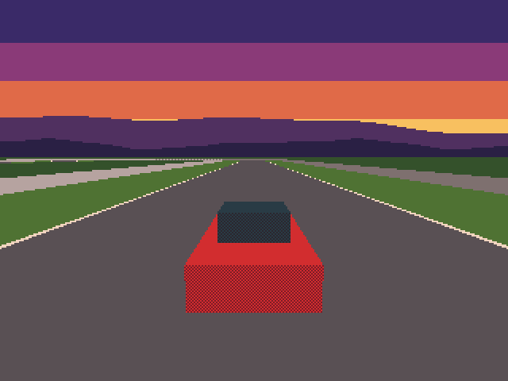
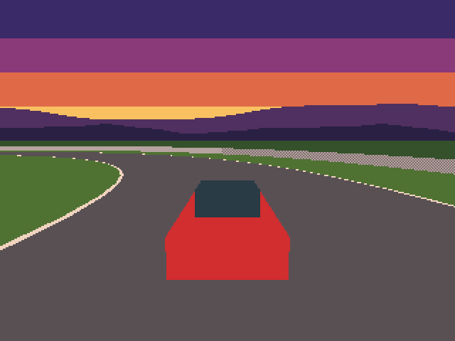
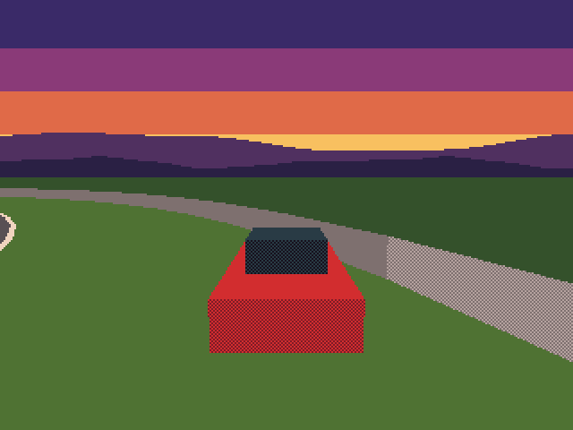
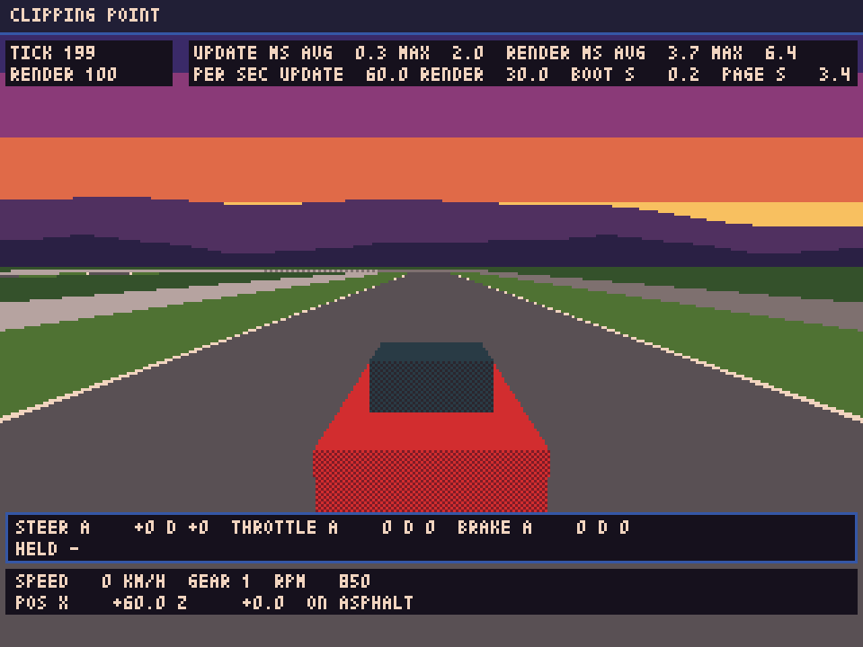
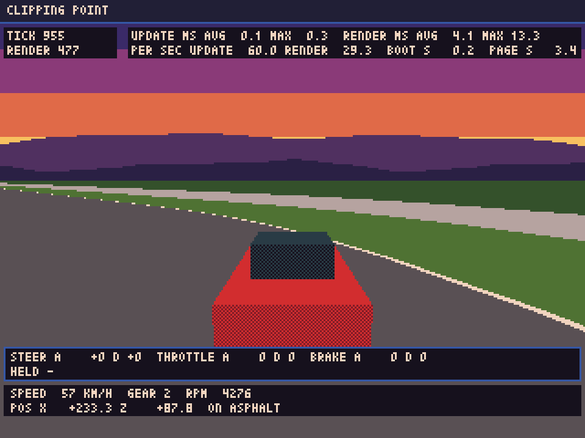
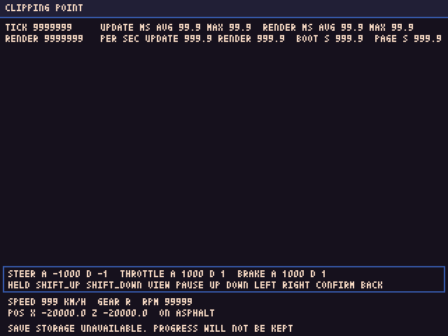

# 進捗レポート 2026-11-13 13

> 要約：段0の区切り10（縦切りの描画と計測）を終えた。車1台が、仮の周回路を走る絵が、デスクトップ版とブラウザ版で出る。段0の10区切りが、全部済んだ。区切りのレビュー（8体）で通った指摘6件（中1、低5）は、全部直した。残りは、段の仕上げ（実機での確認のお願い）。週の使用率は、このモデルの枠が72%、全モデルの合計が81%。

## 前回からの進捗

- 区切り10の実装が入った（実装役を2回。前半：メッシュ用の数値、カメラ、色の役割、車の仮の形、処理時間の輪、定義データ。後半：3Dの場面、アプリの実描画、判定用の実描画、道具）。
  - コースは、全周で3,660三角形（約60 mの塊が12個）。見えない塊は、隠す。車は、箱の仮の形（72三角形）。背景は、夕方の空の帯と、山並み。
  - 座標の決まりを、2つに分けた。コースやカメラの形は、z を反転して、頂点の順も入れ替える。車の模型は、そのまま渡す。試作は、向きが増える方向が、設計と逆だったので、写さずに、実物のPyxelで、左右の柱と、車の印を描いて決めた。
  - 仮の表示を、上の帯と下の帯に分けた（画面の中ほどは、3Dの絵を隠さない）。更新と実描画の時間（平均と最大）、毎秒の回数、起動にかかった時間（`BOOT`）、ページを開いてからの時間（`PAGE`）を出す。
  - 3Dの絵の確かめを、道具に入れた（空の画素、コースと車の画素、左右の柱と車の印の位置、当てたパレット、ふだんの絵と判定用の絵が同じこと）。走る台本の回（コーナーの中まで走る）で、向きの符号の誤りを拾う。
  - ブラウザ版の煙テストに、走行の場面の筋書き（走る台本を900 tick）を足した。
- 処理時間（ブラウザ版。開発環境の、画面なしのChromium。走る台本900 tick。約3,900三角形）：
  - 更新1回は、95%点で0.2〜0.3 ms（線は4 ms）。実描画1回は、95%点で5.2〜6.2 ms（線は12 ms）。
  - 毎秒の更新は59.93〜60.0回（線は59回）、実描画は29.97〜30.04回（線は29回）。
  - デスクトップ版とブラウザ版で、同じ位置の絵の画素が、一致した。世界の状態の差も0。
- 区切りのレビュー（4観点、8体）：指摘13件のうち、反証を通ったのは6件（中1、低5。高は無い）。6件とも直した。主なもの：
  - 中：ふだんの実描画（毎周期の描画）を消しても、どの確かめも通っていた。道具が見ていたのは、結果を書く直前に、アプリが自分で描き直した絵だった。描き直す前の絵も読んで、違う画素の数を見る確かめを足した。実際に、描画を消した複製で、直す前は合格のままだったことを、確かめた。
  - 低：ふつうの起動（検証の口が無い）でだけ、3Dを描かない形にしても、全体の検証が通っていた（お送りするHTMLだけ、3Dが出ない）。ブラウザ版の、何も渡さずに開く筋書きで、画面の色の数を見る確かめを足した（3Dを描くと19色、描かないと4色）。
  - 低：背景を横にずらす量を、向き0でしか確かめていなかった。向きを振って、写す位置を、数で固定したテストを足した。
- 主の検証で外れた、時間に頼る壊さない件1つ（重い実描画でも、毎秒30回を保つ）を、仕込みの形を変えて直した（時間を足す形から、周期の長さを、決めた値にそろえる形へ）。

## 絵

巡回の3Dの絵（決めた位置と向きで描いた絵。画面の2倍）。

| 直線（スタート位置） | コーナーの途中 | 壁の近く（芝の上） |
| --- | --- | --- |
|  |  |  |

ブラウザ版（画面なしのChromiumの、画面の絵）。

| ふつうの起動（何も渡さずに開いて、約3秒） | 走行の場面の筋書き（走る台本の後。コーナーの中） |
| --- | --- |
|  |  |

仮の表示の、極端な値の見本（巡回の画面。2Dだけ）。

絵で気づいたこと（段1へ申し送る）：白線が、遠くで、1画素の点線のように途切れる。面の向きによって、市松の陰が付く。黒と紺が近く、題の帯と、文字の下地の区別が、付きにくい。車輪は、後方追従の視点では、車体に隠れて見えない。

## コミット

| ブランチ | 題 |
| --- | --- |
| `dev` | 段0 区切り10（途中）：頼みの文の見直し（区切り9の後のコードと照らした） |
| `dev` | 段0 区切り10（途中）：頼みの文のレビューの指摘10件の反映 |
| `dev` | 段0 区切り10（途中）：実装の前半（3Dの描画の、純Pythonの部品と定義データ） |
| `dev` | 段0 区切り10（途中）：実装の後半（3Dの場面、アプリの実描画、判定、道具） |
| `dev` | 段0 区切り10（途中）：区切りのレビューの直し |
| `dev` | 段0 区切り10（途中）：壊す件の定数の名の重なりを直した |
| `dev` | 段0 区切り10：縦切りの描画と計測 |

ほかに、小さな途中のコミットが8つ（検証の結果やレビューの結果の記録、控えの書き直し、テストの件数の下限）。

## 検証の数

主の回し直し（直しの後。`python3 tools/verify.py --all --selftest`。2026-11-12 23:36〜2026-11-13 00:02 UTC）：13手順とも合格。回せなかったものは無い。各道具の最後の1行は、作業記録の区切り10の節。

| 道具 | 結果 |
| --- | --- |
| check | 合格。構文108ファイル、層の分離22ファイル、規則ファイル10、正本1つ、分野の見張り92ファイル、定義データ2組 |
| test | 合格。3,173件（区切り9の終わりは2,642件） |
| fingerprint | 合格。筋書き4本（走行の下限つき）、保存する項目6つ。写しは、動いていない |
| screen-check | 合格。2件。はみ出し0 |
| run | 合格。速い経路、本番と同じ経路、試験用データを重ねた回、走る台本の回（900 tick）、壁の台本の回（780 tick）。3Dの絵の確かめは7つ |
| tour | 合格。画面2枚（照らした命令34個）と、3Dの絵3枚 |
| export | 合格。HTMLは195,395バイト（上限は1,000,000バイト） |
| web-smoke | 合格。筋書き6本（走行の場面を足した）。更新が毎秒60.0回、実描画が毎秒30.05回、更新1回が0.4 ms、実描画1回が5.2 ms（95%点。車が止まっている筋書きの値）。デスクトップ版との差は0 |
| selftest-break | 合格。455件（壊す件401、壊さない件54）。約25分 |

主の検証の1回目（23:06〜23:33 UTC）は、selftest-break が、回り切れない（終了コード2）で止まった（外れた件は0件。壊す所が見つからない件が1件）。原因は、主が、直しで足した定数の名が、前からある定数と同じだったこと。名を変え、守りのテストと、壊す件を足して、回し直した。

レビュー：頼みの文のレビュー2体（`docs/reviews/stage0-k10-request.txt`。通った指摘10件）と、区切りのレビュー8体（`docs/reviews/stage0-k10.txt`。通った指摘6件）。未評価は無い。

主が見た絵：最後の検証が作った7枚（巡回の画面2枚、3Dの絵3枚、ブラウザ版の2枚）。見ていない絵：ブラウザ版の、ほかの筋書きの絵4枚。

## 確かめられていないこと

- 実機（起動、画面に出る時間、走行画面の見た目、コントローラーの値、後退の手触り）。段の仕上げで、お願いする。
- 動いている絵（ちらつき、背景の流れ方）。見たのは、止まった絵だけ。
- 車輪は、実物で1度も見ていない（後方追従の視点では、車体に隠れる）。位置は、テストで見ている。
- 壁の台本を、ブラウザ版で回す常設の筋書きは、無い（走行の場面の筋書きは、走る台本だけ）。
- 巡回の画像ファイルの中身の読み戻しと、地面とコースの深度の競り合いの、常設の確かめは、無い。

## 次の手

- 段0の仕上げ：通過条件の確かめ（ブラウザ版の煙テストを、単独で回した値）。HTMLをお送りして、実機での確認をお願いする。そこで止めて、お知らせする。
- `main` へ入れるのは、実機での確認が済んで、了承をいただいてから。
- 段1へは、ご指示があるまで進まない。

## 使用量

- 週の使用率（2026-11-13 00:03 UTC）：このモデルの枠が72%（止める線は、こちらで見る。90%と95%）、全モデルの合計の枠が81%。
- 区切り10は、このモデルの枠で、約30ポイント（42%から72%）。見込み（約28〜30ポイント）のとおり。内訳は、頼みの文の見直しとレビューで約4、実装役の前半で約5、後半で約9、区切りのレビュー8体で約9、主の直しと検証で約3。
- 段の仕上げの見込みは、約2ポイント。段0の終わりは、約74%の見込み。
