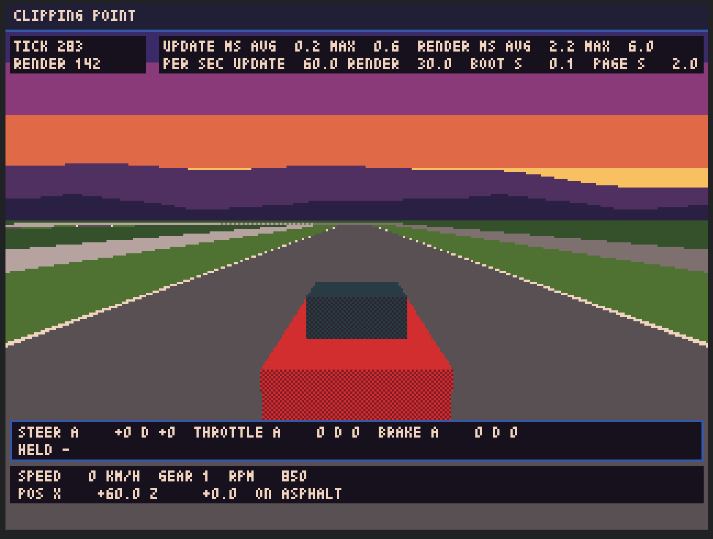

# 進捗レポート 2026-11-13 15

> 要約：お送りしたHTMLが、実機のブラウザで起動した（起動直後の画面の絵と、値をいただいた）。本格的な確認は、夕方以降に、行っていただく。ご指示で、ここで止めた。再開は、ご指示を待つ。再開した後は、週の進行と使用量を見ながら進める。週の使用率は、このモデルの枠が72%、全モデルの合計が82%。

## 前回からの進捗

- 実機での確認（1回目。起動だけ）：HTMLが、PCのブラウザで起動した。本物の取得元からランタイムを読む起動は、開発環境では確かめていなかったので、これで通ったことが分かった。
- いただいた、起動直後の画面の絵：

- 絵から読んだ値と、開発環境の値（どちらも、車が止まっている、スタート位置の絵）：

| 項目 | 実機 | 開発環境（画面なしのChromium） | 線 |
| --- | --- | --- | --- |
| 更新1回の時間（平均／最大） | 0.2 ms／0.6 ms | 0.3 ms／2.0 ms | 4 ms以内（95%点） |
| 実描画1回の時間（平均／最大） | 2.2 ms／6.0 ms | 3.7 ms／6.4 ms | 12 ms以内（95%点） |
| 毎秒の回数（更新／実描画） | 60.0回／30.0回 | 60.0回／30.0回 | 59回以上／29回以上 |
| アプリの起動（`BOOT`） | 0.1秒 | 0.2秒 | - |
| ページを開いてから（`PAGE`。クリックを待った時間を含む） | 2.0秒 | 3.4秒 | - |

- 絵は、開発環境の絵と、同じ構図。画面の4倍に見え、にじみは、見えない。
- ご指示（2026-11-13）を、記録した（常設の方針の「後からいただいた指示」と、根のCLAUDE.mdの「最初に確かめること」）：いまは、止める。再開は、ご指示を待つ（週の枠が戻っても、自分からは再開しない）。再開した後は、週の進行と使用量を見ながら進める。

## お願いと伺いの状態

| # | お願い・伺い | 状態 |
| --- | --- | --- |
| 1 | HTMLを開いて、走行画面が出るか | 済み（出た） |
| 2 | 画面の上の帯の値 | 起動直後の値を、いただいた。走っている間の値は、まだ |
| 3 | 走行画面の見た目の方向に、了承をいただけるか | まだ（夕方以降） |
| 4 | 走ってみた手触り、コントローラーの値の動き | まだ（夕方以降。いまの環境には、コントローラーが無い、とのこと） |
| 5 | `main` へ入れてよいか | まだ |
| 6 | 根のCLAUDE.mdの、使用量の見込みの数字を、実績に書き換えてよいか | まだ |
| 7 | 段1（走りの核）へ進むか | まだ |

夕方以降の確認のときに、あわせて知らせていただけると助かること：ブラウザとOSの種類。走っている間（コーナーの中など）の、上の帯の値。

再開のご指示をいただくときに、伺うこと：再開した後の、止める線。主の解釈は「このモデルの枠の使用率が、週の経過の割合を上回っていたら、その区切りで止める」。1区切りが約20〜30ポイントなので、区切りの途中で上回ることは、ありうる（区切りの途中では止めず、区切りの終わりに上回っていたら、次を始めない）。上回ってよい幅や、週に使ってよい上限があれば、教えていただく。

## コミット

| ブランチ | 題 |
| --- | --- |
| `dev` | 段0 仕上げ：実機での起動の確認の記録と、停止の指示の記録 |

## 検証の数

- 回したもの：静的な検査（合格）と、テスト（合格。3,173件）。変えたのは、文書（根のCLAUDE.md、常設の方針、作業記録、初日のチェックリスト、進捗レポート、控え）だけ。
- 回せなかったもの：無い。

## 次の手

- 止まっている。お返事と、再開のご指示を待つ。自分からは、進めない。

## 使用量

- 週の使用率（2026-11-13 00:12 UTC）：このモデルの枠が72%、全モデルの合計の枠が82%。週の経過は、約38%。
